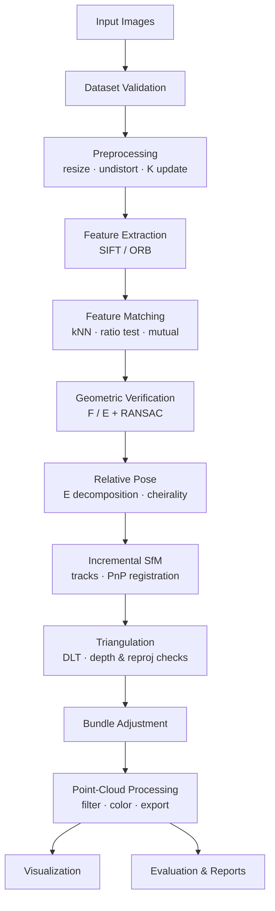

# Multi-View 3D Reconstruction

> Reconstruct the 3D structure of a stationary real-world object or scene from overlapping photographs, using classical geometric computer vision: feature correspondence, epipolar geometry, Structure from Motion (SfM), triangulation, and bundle adjustment.


---

## Contents

1. [Overview](#1-overview)
2. [Problem Statement](#2-problem-statement)
3. [Objectives & Research Questions](#3-objectives--research-questions)
4. [Scope](#4-scope)
5. [System Architecture](#5-system-architecture)
6. [Roadmap (Phase 0 → Phase 11)](#6-roadmap-phase-0--phase-11)
7. [Quick Start](#7-quick-start)
8. [Repository Structure](#8-repository-structure)
9. [Capturing a Dataset](#9-capturing-a-dataset)
10. [Core Concepts](#10-core-concepts)
11. [Outputs](#11-outputs)
12. [Evaluation](#12-evaluation)
13. [Testing Strategy](#13-testing-strategy)
14. [Troubleshooting](#14-troubleshooting)
15. [Limitations](#15-limitations)
16. [Future Work](#16-future-work)
17. [Deliverables](#17-deliverables)
18. [AI-Assisted Development (Claude Code Skills)](#18-ai-assisted-development-claude-code-skills)
19. [References](#19-references)

---

## 1. Overview

A photograph is a 2D projection of a 3D scene — depth is lost. When the same scene is photographed from several viewpoints, corresponding visual features across images constrain both **where the cameras were** and **where the scene points are**. This project builds a modular pipeline that exploits those constraints:

```
photos → features → matches → verified geometry → camera poses → 3D points → cleaned point cloud → evaluation
```

**Example.** Take 40–80 photos walking around a campus statue. The pipeline detects and matches features, recovers the camera path, triangulates landmarks, filters outliers, and exports a navigable sparse point cloud (`.ply`) with the estimated cameras.

### Course alignment (3D Computer Vision)

| Syllabus topic | Where it appears |
|---|---|
| Projective geometry, homogeneous coordinates | Projection model, triangulation (Phases 0, 6) |
| Camera model & image formation | Intrinsics `K`, extrinsics `[R\|t]`, calibration (Phases 0, 1) |
| Feature detection & correspondence | SIFT / ORB, ratio test, mutual check (Phases 2, 3) |
| Two-view & epipolar geometry | Fundamental / essential matrix, RANSAC (Phase 4) |
| Stereo vision foundations | Relative pose, parallax, depth (Phases 5, 6) |
| Structure from Motion | Incremental registration with PnP, tracks, bundle adjustment (Phase 8) |
| 3D data representations | Point clouds, PLY, camera frusta (Phases 7, 9) |
| Dense reconstruction | Optional COLMAP MVS extension (Phase 9) |
| Scaling | Metric scale from a known reference distance (Phase 10) |

**Stack:** Python · OpenCV · NumPy · SciPy · Open3D · Matplotlib · pandas · pytest. COLMAP is an optional reference baseline. PyTorch3D is an optional extension only.

---

## 2. Problem Statement

> Build an end-to-end system that reconstructs the 3D structure of a stationary object or scene from multiple overlapping photographs using classical geometric computer vision, produces a 3D point cloud with estimated camera poses, visualizes every intermediate stage, and quantitatively evaluates the result.

| | |
|---|---|
| **Input** | A directory of overlapping photos · optional camera calibration · optional reference dimensions / ground-truth geometry |
| **Output** | Feature & match diagnostics · camera poses · sparse point cloud · optional dense cloud / mesh · statistics & evaluation report |

Challenges: depth loss in projection; viewpoint, lighting, and scale changes; occlusion; wrong matches; degenerate camera configurations; inherent scale ambiguity.

---

## 3. Objectives & Research Questions

**Objectives**

1. Model camera projection and multi-view geometric relationships.
2. Detect and match correspondences with OpenCV.
3. Estimate epipolar geometry and relative camera motion.
4. Triangulate 3D points and validate them by cheirality and reprojection error.
5. Extend two-view reconstruction to multi-view incremental SfM.
6. Visualize geometry and camera poses; export standard formats.
7. Evaluate quality with reproducible, quantitative experiments.
8. Keep the pipeline modular, tested, and reproducible.

**Research questions** (answered in Phase 10)

- **RQ1** How does the number of input images affect completeness?
- **RQ2** How does feature-matching quality affect the final point cloud?
- **RQ3** How much does calibration accuracy affect reconstruction accuracy?
- **RQ4** How do SIFT vs ORB differ in reliable 3D points produced?
- **RQ5** What are the limits of sparse vs dense reconstruction?

---

## 4. Scope

| Tier | Contents | Phases |
|---|---|---|
| **MVP — two-view** | Load & validate images · SIFT features · matching + ratio test · RANSAC verification · relative pose · triangulation · sparse PLY + viewer · basic stats | 0–7 |
| **Core — multi-view** | Feature tracks · incremental SfM with PnP registration · bundle adjustment · outlier filtering · camera export | 8–9 |
| **Evaluation** | SIFT vs ORB · image-count study · calibration study · COLMAP baseline · metric scale | 10 |
| **Optional** | Dense MVS (COLMAP) · meshing · texturing · simple UI · PyTorch3D | 9 / 16 |

> **Scope decision.** Two-view triangulation alone is *not* SfM. The project is complete only when reconstruction spans many views. Our own implementation is the primary deliverable; COLMAP is used as a **baseline and fallback**, and every externally-provided component is labeled as such in the docs.

---

## 5. System Architecture

### 5.1 Pipeline



### 5.2 Modules

| Module | Responsibility | Key output |
|---|---|---|
| `data/` | Discover, decode, validate, and order images; record metadata; preprocess (undistort, resize) and keep `K` consistent with resizing | `ImageRecord` list + metadata |
| `features/extractor.py` | Detect keypoints on the grayscale image, compute descriptors (SIFT default, RootSIFT, ORB), strict strongest-N cap, content-addressed disk cache | `Features(kps, desc)` per image |
| `features/matcher.py` | Exact brute-force k-NN (or seeded FLANN), Lowe ratio test, mutual check, pair selection, match graph | Candidate matches per pair |
| `geometry/epipolar.py`, `geometry/verification.py` | Own normalised 8-point algorithm; robust `E`/`F` (USAC_ACCURATE, seeded); `auto` picks `E` only with trustworthy intrinsics; Sampson-distance inliers; verified `E` refined on its inliers (Sampson least squares over `R`, `t`); homography ratio for planar/low-parallax pairs | Verified matches + model |
| `geometry/pose_estimation.py` | Own 4-way decomposition of `E` + cheirality (cross-checked against `cv2.recoverPose`), rotation-compensated parallax, initial-pair selection. *Planned (Phase 8): PnP for new views* | Relative poses, initial pair |
| `geometry/camera.py`, `geometry/triangulation.py`, `geometry/reprojection.py` | `Camera(K, R, t)`; observation-list N-view DLT (own, batched), Gauss-Newton point refinement, filters (≥ 2 views, finite, in front of every camera, max reprojection error, triangulation angle); reprojection statistics | 3D landmarks |
| `reconstruction/two_view.py` | Initial structure: the initial pair's verified matches triangulated and filtered | `TwoViewStructure` |
| `reconstruction/` *(planned, Phase 8)* | Camera registry, landmarks ↔ observations, tracks, incremental SfM loop, bundle adjustment (SciPy `least_squares`) | Scene graph: cameras + landmarks |
| `pointcloud/` | Colours sampled bilinearly at every observation and averaged; PLY via Open3D's tensor API; `cameras.json`. *Planned (Phase 9): statistical outlier removal* | `sparse.ply`, `cameras.json` |
| `visualization/` | Keypoint & match images, epipolar lines, reprojection histograms, top/side camera plots; `viewer.py`: Open3D scene (cloud + camera frusta), interactive `draw()` window and offscreen renders (overview, close-up) | PNG figures, interactive view |
| `evaluation/` | Pose metrics and ground-truth loading (Middlebury format). *Planned (Phase 10): experiment runner, reports, plots* | Error tables |
| `pipeline.py` | Library pipeline: `run_pipeline(images, config, until=...)` → `PipelineResult` (features → matches → verify → pose → triangulate → cloud) | In-memory results |
| `cli.py` / `run.py` | Commands per stage; run directories with config, environment and per-stage outputs; shared CSV writer | Reproducible run directories |

### 5.3 Design principles

- **Stage isolation.** Each stage reads/writes explicit data objects and saves intermediates, so failures are traceable to one stage.
- **Ground truth first.** A synthetic scene generator (known `K`, poses, 3D points) is built in Phase 0, so every geometry module is tested against exact answers before touching real photos.
- **Config, not constants.** All thresholds live in `configs/*.yaml`; every run records its config, versions, and hardware.
- **One coordinate convention**, documented once: world→camera `x_cam = R·X + t`, camera center `C = −Rᵀt`, pixel coordinates with origin at top-left.

---

## 6. Roadmap (Phase 0 → Phase 11)

Detailed task lists, deliverables, exit criteria, and risks for every phase are in **[docs/ROADMAP.md](docs/ROADMAP.md)**.

| Phase | Name | Key deliverable | Exit criterion | Milestone |
|---|---|---|---|---|
| **0** | **Foundation & environment** | Python 3.12 env, scaffold, config, synthetic scene generator, CI-ready pytest | `verify_setup.py` passes; synthetic projection test green | — |
| 1 | Dataset loading & validation | `loader.py`, `validation.py`, `preprocessing.py` | Deterministic order, clear errors, `K` scales with resize | — |
| 2 | Feature extraction | SIFT/ORB extractor + cache + keypoint figures | Stable counts on sample set; cache hit on rerun | — |
| 3 | Feature matching | Ratio test + mutual check + match figures | Valid indices; visually plausible matches | — |
| 4 | Geometric verification | `F`/`E` + RANSAC + epipolar-line plots | Synthetic: recovers `E` up to scale; real: stable inlier ratio | — |
| 5 | Relative camera pose | Own `E` decomposition + cheirality (checked against `cv2.recoverPose`), initial pair | Synthetic: rotation error < 0.1° (noise-free) | — |
| 6 | Triangulation | DLT triangulation + depth/reproj/parallax filters | Synthetic: sub-pixel reprojection error | — |
| 7 | Two-view sparse cloud | Colored PLY + Open3D viewer + camera frusta | Recognizable structure from one real pair | **M1: two-view MVP** |
| 8 | Multi-view incremental SfM | Tracks, PnP registration, BA | ≥ 80 % of images registered on sample set | — |
| 9 | Filtering, export (+ optional dense) | `filtered.ply`, `cameras.json`, optional COLMAP MVS | Reload round-trip; before/after point counts logged | **M2: multi-view** |
| 10 | Evaluation & experiments | RQ1–RQ5 experiments, COLMAP baseline, plots | All experiments reproducible from config | — |
| 11 | Documentation & presentation | Report, architecture/method docs, demo | Checklist complete | **M3: submission** |

### Phase 0 at a glance (✅ done)

1. Create a Python **3.12** virtual environment with `uv` (system Python 3.14 lacks Open3D wheels).
2. Pin dependencies in `pyproject.toml`; verify `cv2.SIFT_create` and Open3D import.
3. Scaffold `src/`, `tests/`, `configs/`, `data/`, `outputs/`, `docs/`; add `.gitignore` for data and outputs.
4. Write `configs/default.yaml` and a typed config loader.
5. Build `tests/synthetic.py`: random 3D points + N cameras with known `K, R, t` → noisy 2D observations.
6. First green tests: projection round-trip and config loading.
7. Document coordinate conventions in `docs/architecture.md`.

---

## 7. Quick Start

> Commands below become valid as their phases land. Until then they describe the target interface.

### 7.1 Environment (Phase 0)

```bash
git clone <repo-url> Multi-View-3D-Reconstruction
cd Multi-View-3D-Reconstruction

# macOS only: the Open3D 0.20 wheel links against Homebrew's libusb
brew install libusb

# Python 3.12 — Open3D does not publish wheels for 3.14 yet
uv venv --python 3.12 .venv
source .venv/bin/activate
uv pip install -e ".[dev]"

python scripts/verify_setup.py
pytest -q
```

Windows PowerShell: `.venv\Scripts\Activate.ps1` instead of `source`.

Use **one** OpenCV wheel only (`opencv-contrib-python`). Do not mix it with `opencv-python` or headless variants.

### 7.2 Get a real dataset with ground truth

```bash
python scripts/download_middlebury.py templeRing        # 47 real photos + true K, R, t → data/raw/templeRing/
python scripts/evaluate_against_ground_truth.py data/raw/templeRing   # pipeline vs ground truth
```

See [`data/sample/README.md`](data/sample/README.md) for sources, licences and current results.

### 7.3 Check a dataset

```bash
# load, validate and summarise a photo folder → outputs/<timestamp>_validate/dataset.json
python -m src.cli validate data/raw/sample_scene

# optional: calibrate from checkerboard photos (inner corners 9x6, 25 mm squares)
python -m src.cli calibrate data/raw/checkerboard --pattern 9x6 --square 0.025 --out configs/camera.yaml
# then set camera.calibration_file: configs/camera.yaml in your config

# detect keypoints → outputs/<timestamp>_features_sift/features/{feature_statistics.csv, *_keypoints.png}
python -m src.cli features data/raw/sample_scene                 # SIFT (default)
python -m src.cli features data/raw/sample_scene --detector orb  # ORB for comparison

# match image pairs → outputs/<timestamp>_matches_sift/matches/
#   match_statistics.csv, matches.npz, match_matrix.png, <a>_<b>_matches.png
python -m src.cli matches data/raw/sample_scene
python -m src.cli matches data/raw/sample_scene --ratio 0.8 --pairs sequential

# verify pairs with epipolar geometry → .../verification/
#   verification_statistics.csv, verified_matches.npz, verified_matrix.png,
#   <a>_<b>_inliers.png (green inliers / red outliers), <a>_<b>_epipolar.png
python -m src.cli verify data/raw/sample_scene
python -m src.cli verify data/raw/sample_scene --method fundamental --threshold 2.0

# relative pose of every verified pair and the initial pair for reconstruction → .../pose/
#   relative_poses.csv, initial_pair.json (R, unit t), initial_pair.png (top + side view)
python -m src.cli pose data/raw/sample_scene

# triangulate and filter the initial pair → .../triangulation/
#   triangulation.json (counts per filter, reprojection stats), points.npz,
#   reprojection_histogram.png, structure.png
python -m src.cli triangulate data/raw/sample_scene
```

Calibrate if you can: on rendered views the initial-pair pose is exact with the true `K` (0.00° rotation error) but off by 1.75° with a guessed focal length 20 % too long.

`notebooks/02_feature_matching.ipynb` shows the match graph, matches for one pair, the ratio-test histogram for choosing `matching.ratio`, and a SIFT vs ORB comparison.

Matching costs ~0.1–0.16 s per pair at 8000 SIFT features on an M-series Mac. `pair_mode: auto` (default) matches every pair up to 50 images and switches to a sequential window above that; force either with `--pairs exhaustive|sequential`. Geometric verification runs pairs on `performance.workers` threads; extraction and matching run sequentially because OpenCV already parallelises SIFT and `batchDistance` internally (threading on top was slower).

Prepared images, features and matches are cached under `outputs/cache/` (`output.cache_dir`; `null` disables), keyed by content and every relevant setting, so repeat commands skip work and any change recomputes automatically. Options that change the pipeline (`--detector`, `--ratio`, `--pairs`, `--method`, `--threshold`, `--out`) map to config keys, are validated like the YAML file and are recorded in each run's `config.yaml`; `--config` selects the file and `--draw` only controls diagnostic images. If no calibration file is configured and the image folder contains `camera.yaml` (as written by `calibrate` or the Middlebury downloader), it is used automatically.

`notebooks/01_dataset_exploration.ipynb` shows thumbnails, blur scores, image similarity and per-image intrinsics for a folder.

Intrinsics are chosen per image in this order: calibration file → EXIF 35 mm-equivalent focal length → fallback `f = 1.2 · max(w, h)`. Images are downscaled to `preprocessing.max_side` (default 1600 px) and `K` is rescaled to match.

### 7.4 Two-view reconstruction (milestone M1)

```bash
# initial pair -> coloured sparse cloud, cameras and renders
python -m src.cli two-view data/raw/templeRing   # uses data/raw/templeRing/camera.yaml
#   .../point_clouds/sparse.ply · camera_poses/cameras.json
#   .../figures/two_view.png (overview with camera frusta) · two_view_closeup.png

# interactive 3-D viewer (Open3D window)
python -m src.cli view outputs/<run>/point_clouds/sparse.ply --cameras outputs/<run>/camera_poses/cameras.json
```

`notebooks/03_two_view_geometry.ipynb` walks the initial pair from verified matches to the coloured cloud, with a ground-truth check when `gt_cameras.json` exists.

Planned for Phase 8–9: `python -m src.cli reconstruct <images>` (all views) and `filtered.ply`.

### 7.5 COLMAP (optional, Phase 9–10)

```bash
brew install colmap           # macOS
colmap -h                     # verify
```

COLMAP is a system dependency; installing Python requirements does not install it. See https://colmap.github.io/.

---

## 8. Repository Structure

Current layout; entries marked *(planned)* arrive with their phase.

```text
Multi-View-3D-Reconstruction/
├── README.md
├── CLAUDE.md                     # guidance for Claude Code sessions
├── pyproject.toml                # pinned deps + tool config
├── skills-lock.json              # pinned Claude Code skills
├── .claude/skills/               # project-level Claude Code skills
├── configs/
│   ├── default.yaml              # all thresholds & switches
│   └── camera.example.yaml       # format of camera.yaml (written by `cli calibrate`)
├── data/                         # git-ignored except data/sample/
│   ├── raw/<scene>/              # input photos
│   ├── processed/
│   └── sample/                   # tiny committed test set
├── outputs/                      # git-ignored; one subfolder per run
├── src/
│   ├── config.py      # typed config (frozen dataclasses), YAML loader
│   ├── run.py         # run directories, environment capture, CSV writer
│   ├── pipeline.py    # run_pipeline → PipelineResult
│   ├── cli.py
│   ├── data/          loader.py · validation.py · preprocessing.py · dataset.py
│   ├── features/      extractor.py · matcher.py
│   ├── geometry/      calibration.py · epipolar.py · verification.py · pose_estimation.py
│   │                  camera.py · triangulation.py · reprojection.py
│   ├── visualization/ common.py · features.py · matches.py · epipolar.py · cameras.py
│   │                  reprojection.py · viewer.py
│   ├── reconstruction/ two_view.py · (planned) sfm.py · tracks.py · bundle_adjustment.py
│   ├── pointcloud/    coloring.py · export.py · (planned) filtering.py
│   └── evaluation/    metrics.py · ground_truth.py · (planned) experiments.py · reports.py
├── tests/
│   ├── synthetic.py              # 3D points + cameras with exact ground truth
│   ├── render.py                 # rendered textured box scene from known cameras
│   ├── images.py                 # textures, view sequences with known homographies, checkerboards
│   ├── conftest.py
│   └── test_*.py
├── notebooks/                    # 01_dataset_exploration · 02_feature_matching · 03_two_view_geometry (04 planned)
├── docs/
│   ├── ROADMAP.md                # detailed phase plans
│   ├── architecture.md
│   ├── methodology.md            # (planned)
│   └── experiments.md            # (planned)
└── scripts/
    ├── verify_setup.py
    ├── download_middlebury.py    # real dataset + ground-truth cameras
    └── evaluate_against_ground_truth.py
```

---

## 9. Capturing a Dataset

**Good first subjects:** a textured statue, sculpture, textured box, or small architectural feature. Small objects are easier to capture and inspect than large outdoor scenes.

**Capture guidelines**

1. 40–80 photos as a starting point (more for complex shapes).
2. ~60–80 % overlap between consecutive shots; walk around the object in an arc.
3. Vary height as well as angle; ensure real parallax — don't rotate in place.
4. Fixed focus/zoom and consistent exposure; avoid motion blur.
5. Avoid lighting changes, moving objects, and relying only on textureless, shiny, transparent, or repetitive surfaces.
6. Keep the folder free of unrelated photos.

**Layout:** `data/raw/<scene_name>/image_001.jpg, image_002.jpg, …`

**Validation checklist:** all images decode · dimensions recorded · object static · no severe blur · identifiable texture · EXIF focal length recorded if present.

If intrinsics are unknown, start from an estimate (`f ≈ 1.2 × max(width, height)`, principal point at image center), but prefer checkerboard calibration (`cv2.calibrateCamera`) with the same camera, focus, and resolution.

---

## 10. Core Concepts

**Camera projection**

$$\mathbf{x} \sim K\,[R \mid t]\,\mathbf{X}$$

`X` is a homogeneous 3D point, `K` the intrinsic matrix, `[R|t]` the world→camera transform, `x` the homogeneous pixel, and `∼` equality up to scale.

**Epipolar constraint**

$$\mathbf{x}_2^{\top} F\, \mathbf{x}_1 = 0 \qquad\qquad \hat{\mathbf{x}}_2^{\top} E\, \hat{\mathbf{x}}_1 = 0,\quad E = [t]_\times R,\quad F = K_2^{-\top} E\, K_1^{-1}$$

`F` relates pixel coordinates (uncalibrated); `E` relates normalized coordinates `x̂ = K⁻¹x` (calibrated).

**Triangulation** recovers `X` from two or more observations with known projection matrices `P_i = K_i[R_i|t_i]` (linear DLT, optionally refined). Valid points have positive depth in every observing camera and low reprojection error.

**Reprojection error**

$$e_{\text{mean}} = \frac{1}{N}\sum_{i=1}^{N} \left\lVert \mathbf{x}_i - \hat{\mathbf{x}}_i \right\rVert_2$$

measured in pixels. Bundle adjustment minimizes the (robustified) sum of squared reprojection errors over all cameras and points.

**Scale ambiguity.** Monocular reconstruction is defined only up to a similarity transform (rotation, translation, global scale). Metric scale needs an external reference — a known distance, calibrated baseline, or measured object dimension.

---

## 11. Outputs

Each command writes `outputs/<timestamp>_<command>_<detector>/`, containing every stage it ran — `features` writes only `features/`, `pose` stops after `pose/`, `triangulate` adds `triangulation/`, and `two-view` adds the cloud, cameras and renders. Per-image / per-pair diagnostic images are drawn only by `features`, `matches` and `verify`, and only for that command's own stage (`--draw N` images or pairs, default 3; `pose`, `triangulate` and `two-view` have no `--draw`). A full `two-view` run:

```text
outputs/<timestamp>_two_view_sift/
├── config.yaml                   # exact config used
├── environment.json              # versions, hardware, git commit
├── dataset.json                  # per-image size, scale, intrinsics
├── features/      feature_statistics.csv
├── matches/       match_statistics.csv · matches.npz · match_matrix.png
├── verification/  verification_statistics.csv · verified_matches.npz · verified_matrix.png
├── pose/          relative_poses.csv · initial_pair.json · initial_pair.png
├── triangulation/ triangulation.json · points.npz · reprojection_histogram.png · structure.png
├── point_clouds/  sparse.ply
├── camera_poses/  cameras.json
└── figures/       two_view.png · two_view_closeup.png
```

Planned with later phases: `point_clouds/filtered.ply`, `(dense.ply)`, `meshes/`, `reports/`. Parenthesized files appear only when optional modules are enabled. A complete textured mesh is **not** expected from sparse SfM alone.

**Demo should show:** input photos → keypoints → raw matches → geometric inliers → camera poses → sparse cloud → cleaned cloud → (dense / mesh) → metrics.

---

## 12. Evaluation

### Metrics

| Metric | Measures |
|---|---|
| Features per image | Detector output |
| Raw / filtered matches per pair | Correspondence quantity |
| Inlier ratio | Fraction surviving geometric verification |
| Registered cameras | Multi-view coverage (multi-view only) |
| Sparse point count, mean track length | Reconstruction density & redundancy |
| Mean / median reprojection error (px) | Image-space consistency |
| Runtime per stage | Efficiency |
| Completeness, Chamfer distance | 3D accuracy vs reference (after similarity alignment) |
| Pose error (rotation °, translation direction °) | Synthetic / COLMAP-relative accuracy |

Report only metrics meaningful for the implementation tier (e.g. no camera-registration stats for the two-view prototype).

### Experiments (Phase 10)

| Experiment | Variable | Held constant | Answers |
|---|---|---|---|
| E1 Image count | 10 / 20 / 40 / all images | Detector, thresholds | RQ1 |
| E2 Matching thresholds | Ratio 0.6–0.9, mutual on/off | Images, detector | RQ2 |
| E3 Calibration | Calibrated vs EXIF vs guessed `K` | Images, detector | RQ3 |
| E4 Detector | SIFT vs ORB | Resolution, pairs, RANSAC settings | RQ4 |
| E5 Bundle adjustment | On vs off | Everything else | quality gain |
| E6 Baseline | Ours vs COLMAP sparse (and dense) | Same image set | RQ5 |

**Without ground truth**, reprojection error and completeness are internal diagnostics only — they do not establish absolute 3D accuracy. With reference geometry, align first (Umeyama similarity or ICP) and then compute Chamfer / completeness.

**Reproducibility:** every experiment records dataset ID, image count, full config, calibration, software versions, hardware, runtime, metrics, and output paths in CSV/JSON.

---

## 13. Testing Strategy

| Level | What | How |
|---|---|---|
| **Synthetic ground truth** | Projection, `E`/`F`, pose, triangulation, PnP, BA | `tests/synthetic.py` generates exact scenes; assert errors below tolerances with and without pixel noise |
| **Unit** | Loader (valid / corrupt / empty dir), extractor (textured vs blank image), matcher (index validity), geometry shapes & failure on too few points | pytest, parametrized |
| **Integration** | Full pipeline on `data/sample/` | Completes, writes intermediates, outputs reload, metrics reproducible within tolerance |
| **Visual** | Matches, epipolar lines, trajectories, clouds | Manual inspection checklist each phase |

Test-first for geometry: write the synthetic test, watch it fail, implement, watch it pass. Automated tests cannot prove a point cloud looks like the object — visual inspection is a required step.

---

## 14. Troubleshooting

| Symptom | Likely causes | Fixes |
|---|---|---|
| **Too few matches** | Low overlap, little texture, blur, lighting change | Recapture with more overlap; SIFT over ORB; inspect match images; choose better pairs |
| **Wrong camera pose** | Outlier matches, wrong `K`, small baseline, planar/degenerate scene | Stricter RANSAC; check `K` after resizing; inspect epipolar residuals; check cheirality counts; pick pair with more parallax |
| **Scattered point cloud** | Bad matches, poor poses, wrong `P`, low-parallax points | Filter by reprojection error and triangulation angle; verify coordinate conventions module-by-module |
| **Wrong real-world size** | Scale ambiguity (expected) | Scale by a measured reference distance |
| **Incomplete dense result** | Low texture, reflections, occlusion, coverage gaps, bad poses | Improve capture; verify sparse first; document unrecoverable regions |
| **High memory / slow** | Large images, too many pairs/features | Resize (update `K`); cap features; cache descriptors; restrict pairs (sequential window or vocabulary) |
| **`SIFT_create` missing** | Old or mixed OpenCV wheels | Uninstall all `opencv-*`, install only `opencv-contrib-python` |
| **`open3d` won't install** | Unsupported Python version | Use Python 3.12 (see Quick Start) |
| **`Library not loaded: …libusb-1.0.0.dylib`** | Open3D 0.20 macOS wheel needs libusb | `brew install libusb` |

---

## 15. Limitations

1. Quality depends on overlap and visible texture.
2. Textureless, reflective, transparent, and repetitive surfaces are unreliable.
3. Moving objects violate the static-scene assumption.
4. Sparse clouds do not represent complete surfaces.
5. Dense reconstruction and meshing add significant compute and algorithmic complexity.
6. No metric scale without an external reference.
7. Calibration errors propagate into geometry.
8. Low reprojection error ≠ accurate 3D geometry.
9. Results vary across datasets and camera setups.

These are reported in the final write-up alongside failure cases — not hidden behind favorable screenshots.

---

## 16. Future Work

Dense MVS · surface meshing (Poisson / ball-pivoting) · texture mapping · camera calibration study · learned features (SuperPoint/LightGlue) comparison · loop-closure / global SfM · COLMAP comparison on public benchmarks (e.g. ETH3D, Tanks & Temples) · PyTorch3D mesh refinement or differentiable rendering · simple web/desktop UI.

---

## 17. Deliverables

- **Code:** modular Python package, pinned dependencies, configs, tests, run instructions.
- **Dataset:** documented capture (or download procedure), calibration details. Large data and outputs are *not* committed.
- **Results:** match & epipolar diagnostics, camera-pose plots, sparse (and optional dense) clouds, metric tables and plots.
- **Docs:** README, architecture diagram, methodology, experiment setup, results & discussion, limitations, future work.
- **Presentation:** problem → geometry → architecture → workflow → results → limitations → conclusions.

### Completion checklist

- [x] **Phase 0** Environment, scaffold, config, synthetic generator
- [x] **Phase 1** Dataset loading & validation
- [x] **Phase 2** Feature extraction
- [x] **Phase 3** Feature matching
- [x] **Phase 4** Geometric verification
- [x] **Phase 5** Relative camera pose
- [x] **Phase 6** Triangulation
- [x] **Phase 7** Two-view sparse cloud + viewer — *M1* ✅
- [ ] **Phase 8** Multi-view incremental SfM + BA
- [ ] **Phase 9** Filtering & export (+ optional dense) — *M2*
- [ ] **Phase 10** Evaluation & experiments
- [ ] **Phase 11** Documentation & presentation — *M3*

**Definition of success:** reliably turn a suitable set of overlapping photos into a coherent multi-view 3D reconstruction, explain the geometry behind it, and back it with quantitative, reproducible evidence.

---

## 18. AI-Assisted Development (Claude Code Skills)

This repo ships project-level [Claude Code](https://claude.com/claude-code) skills in `.claude/skills/`, pinned by `skills-lock.json`, discovered via the [skills.sh](https://skills.sh/) registry:

| Skill | Source | Used in phases |
|---|---|---|
| `computer-vision-opencv` | `mindrally/skills` | 1–8 (OpenCV features, matching, RANSAC) |
| `open3d-python` | `isl-org/open3d` (official) | 7, 9, 10 (point clouds, IO, viewer, ICP alignment) |
| `python-testing-patterns` | `wshobson/agents` | 0–10 (pytest, fixtures, parametrization) |
| `matplotlib` | `k-dense-ai/scientific-agent-skills` | 2–4, 10 (diagnostic figures, evaluation plots) |
| `jupyter-notebook` | `openai/skills` | 1–10 (analysis notebooks) |

Also used from the user-level set: `tdd`, `systematic-debugging`, `brainstorming`, `code-review`.

Restore on a new machine: `npx skills experimental_install`. See [CLAUDE.md](CLAUDE.md) for how sessions should use them.

---

## 19. References

1. R. Szeliski — *Computer Vision: Algorithms and Applications*, 2nd ed. https://szeliski.org/Book/
2. R. Hartley & A. Zisserman — *Multiple View Geometry in Computer Vision*, 2nd ed., Cambridge University Press.
3. J. L. Schönberger & J.-M. Frahm — "Structure-from-Motion Revisited," CVPR 2016.
4. D. G. Lowe — "Distinctive Image Features from Scale-Invariant Keypoints," IJCV 2004.
5. B. Triggs et al. — "Bundle Adjustment — A Modern Synthesis," Vision Algorithms 1999.
6. OpenCV documentation — https://docs.opencv.org/
7. Open3D documentation — https://www.open3d.org/docs/
8. COLMAP documentation — https://colmap.github.io/
