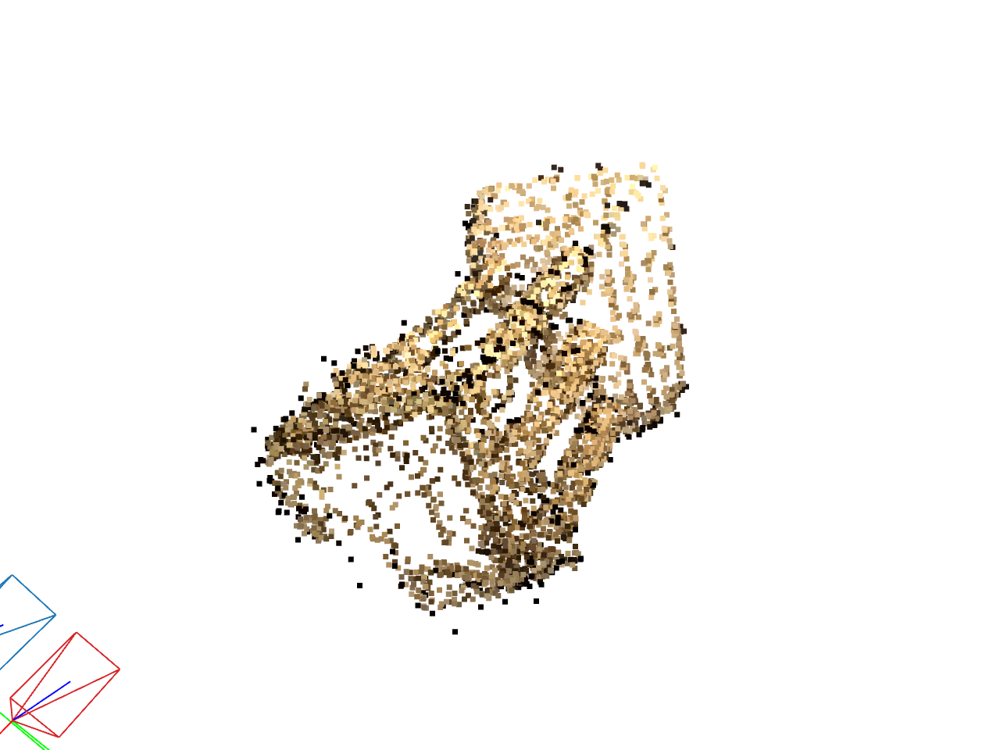
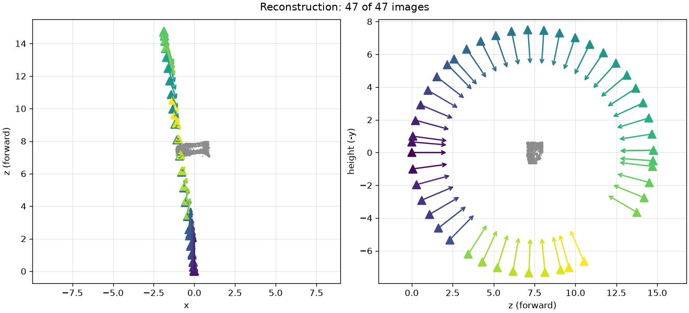
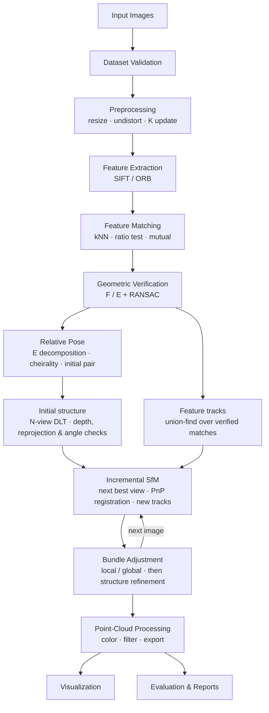
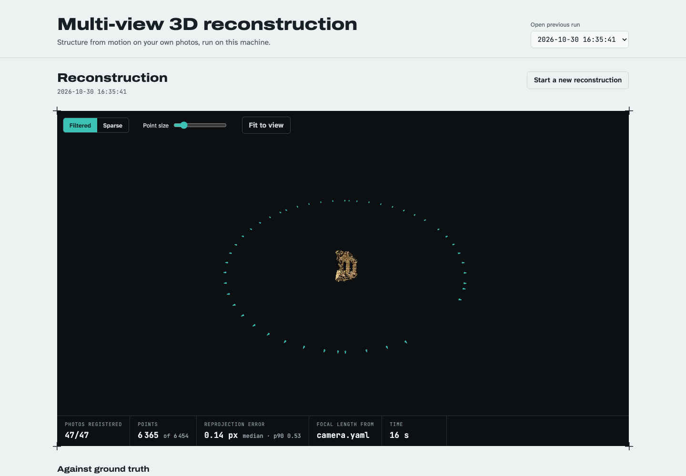

# Multi-View 3D Reconstruction

> Reconstruct the 3D structure of a stationary real-world object or scene from overlapping photographs, using classical geometric computer vision: feature correspondence, epipolar geometry, Structure from Motion (SfM), triangulation, and bundle adjustment.


---

## Contents

1. [Overview](#1-overview)
2. [Problem Statement](#2-problem-statement)
3. [Objectives & Research Questions](#3-objectives--research-questions)
4. [Scope](#4-scope)
5. [System Architecture](#5-system-architecture)
6. [Roadmap (Phase 0 → Phase 12)](#6-roadmap-phase-0--phase-12)
7. [Quick Start](#7-quick-start)
8. [Repository Structure](#8-repository-structure)
9. [Capturing a Dataset](#9-capturing-a-dataset)
10. [Core Concepts](#10-core-concepts)
11. [Outputs](#11-outputs)
12. [Evaluation](#12-evaluation)
13. [Testing Strategy](#13-testing-strategy)
14. [Troubleshooting](#14-troubleshooting)
15. [Limitations](#15-limitations)
16. [Future Work](#16-future-work)
17. [Deliverables](#17-deliverables)
18. [AI-Assisted Development (Claude Code Skills)](#18-ai-assisted-development-claude-code-skills)
19. [References](#19-references)

---

## 1. Overview

A photograph is a 2D projection of a 3D scene — depth is lost. When the same scene is photographed from several viewpoints, corresponding visual features across images constrain both **where the cameras were** and **where the scene points are**. This project builds a modular pipeline that exploits those constraints:

```
photos → features → matches → verified geometry → camera poses → 3D points → cleaned point cloud → evaluation
```

**Example.** Take 40–80 photos walking around a campus statue. The pipeline detects and matches features, recovers the camera path, triangulates landmarks, filters outliers, and exports a navigable sparse point cloud (`.ply`) with the estimated cameras.

### Results at a glance

On the Middlebury **templeRing** set (47 real photos of a plaster temple, 640×480, with ground-truth cameras):

| | |
|---|---|
|  |  |
| Filtered sparse cloud (6365 coloured points) | All 47 cameras recovered: top and side views |

| Result | Value |
|---|---|
| Images registered | **47 / 47** |
| Camera rotation error vs ground truth (median / max) | **0.15° / 0.41°** |
| Camera position error (median, fraction of the ring's radius) | **0.18 %** |
| Reprojection error (mean) | **0.23 px** |
| Completeness vs reference | **0.92** |
| Runtime of `reconstruct` (Apple M4) | **20 s** cold, 16 s with caches |

Experiments (RQ1–RQ4, [docs/experiments.md](docs/experiments.md)): completeness is limited by the spacing between views, not their number; a Lowe ratio of 0.7–0.8 with the mutual check works best; **a 5 % focal-length error halves completeness while the reprojection error stays flat**; SIFT beats ORB on reliable points; bundle adjustment cuts pose errors 4×.

### Course alignment (3D Computer Vision)

| Syllabus topic | Where it appears |
|---|---|
| Projective geometry, homogeneous coordinates | Projection model, triangulation (Phases 0, 6) |
| Camera model & image formation | Intrinsics `K`, extrinsics `[R\|t]`, calibration (Phases 0, 1) |
| Feature detection & correspondence | SIFT / ORB, ratio test, mutual check (Phases 2, 3) |
| Two-view & epipolar geometry | Fundamental / essential matrix, RANSAC (Phase 4) |
| Stereo vision foundations | Relative pose, parallax, depth (Phases 5, 6) |
| Structure from Motion | Incremental registration with PnP, tracks, bundle adjustment (Phase 8) |
| 3D data representations | Point clouds, PLY, camera frusta (Phases 7, 9) |
| Dense reconstruction | Future work (RQ5) |
| Scaling | Metric scale from a known reference distance (Phase 10) |

**Stack:** Python · OpenCV · NumPy · SciPy · Open3D · Matplotlib · pandas · pytest. Which parts are our own implementation and which come from these libraries is listed in [docs/methodology.md](docs/methodology.md#12-ours-vs-external). COLMAP is not used (a COLMAP baseline and dense reconstruction are future work). The optional web interface (§7.7) uses **FastAPI** and **uvicorn** (server) and **three.js** (browser viewer, loaded from a CDN) — all external.

---

## 2. Problem Statement

> Build an end-to-end system that reconstructs the 3D structure of a stationary object or scene from multiple overlapping photographs using classical geometric computer vision, produces a 3D point cloud with estimated camera poses, visualizes every intermediate stage, and quantitatively evaluates the result.

| | |
|---|---|
| **Input** | A directory of overlapping photos · optional camera calibration · optional reference dimensions / ground-truth geometry |
| **Output** | Feature & match diagnostics · camera poses · sparse point cloud · optional dense cloud / mesh · statistics & evaluation report |

Challenges: depth loss in projection; viewpoint, lighting, and scale changes; occlusion; wrong matches; degenerate camera configurations; inherent scale ambiguity.

---

## 3. Objectives & Research Questions

**Objectives**

1. Model camera projection and multi-view geometric relationships.
2. Detect and match correspondences with OpenCV.
3. Estimate epipolar geometry and relative camera motion.
4. Triangulate 3D points and validate them by cheirality and reprojection error.
5. Extend two-view reconstruction to multi-view incremental SfM.
6. Visualize geometry and camera poses; export standard formats.
7. Evaluate quality with reproducible, quantitative experiments.
8. Keep the pipeline modular, tested, and reproducible.

**Research questions** (RQ1–RQ4 answered in [docs/experiments.md](docs/experiments.md); RQ5 is future work)

- **RQ1** How does the number of input images affect completeness?
- **RQ2** How does feature-matching quality affect the final point cloud?
- **RQ3** How much does calibration accuracy affect reconstruction accuracy?
- **RQ4** How do SIFT vs ORB differ in reliable 3D points produced?
- **RQ5** What are the limits of sparse vs dense reconstruction?

---

## 4. Scope

| Tier | Contents | Phases |
|---|---|---|
| **MVP — two-view** | Load & validate images · SIFT features · matching + ratio test · RANSAC verification · relative pose · triangulation · sparse PLY + viewer · basic stats | 0–7 |
| **Core — multi-view** | Feature tracks · incremental SfM with PnP registration · bundle adjustment · outlier filtering · camera export | 8–9 |
| **Evaluation** | SIFT vs ORB · image-count study · matching study · calibration study · bundle-adjustment ablation · metric scale (COLMAP baseline: future work) | 10 |
| **Optional** | Dense MVS (COLMAP) · meshing · texturing · simple UI · PyTorch3D | 9 / 16 |

> **Scope decision.** Two-view triangulation alone is *not* SfM. The project is complete only when reconstruction spans many views. Our own implementation is the primary deliverable; COLMAP is used as a **baseline and fallback**, and every externally-provided component is labeled as such in the docs.

---

## 5. System Architecture

### 5.1 Pipeline



### 5.2 Modules

| Module | Responsibility | Key output |
|---|---|---|
| `data/` | Discover, decode, validate, and order images; record metadata; preprocess (undistort, resize) and keep `K` consistent with resizing | `ImageRecord` list + metadata |
| `features/extractor.py` | Detect keypoints on the grayscale image, compute descriptors (SIFT default, RootSIFT, ORB), strict strongest-N cap, content-addressed disk cache | `Features(kps, desc)` per image |
| `features/matcher.py` | Exact brute-force k-NN (or seeded FLANN), Lowe ratio test, mutual check, pair selection, match graph | Candidate matches per pair |
| `geometry/epipolar.py`, `geometry/verification.py` | Own normalised 8-point algorithm; robust `E`/`F` (USAC_ACCURATE, seeded); `auto` picks `E` only with trustworthy intrinsics; Sampson-distance inliers; verified `E` refined on its inliers (Sampson least squares over `R`, `t`); homography ratio for planar/low-parallax pairs | Verified matches + model |
| `geometry/pose_estimation.py` | Own 4-way decomposition of `E` + cheirality (cross-checked against `cv2.recoverPose`), rotation-compensated parallax, initial-pair selection | Relative poses, initial pair |
| `geometry/camera.py`, `geometry/triangulation.py`, `geometry/reprojection.py` | `Camera(K, R, t)`; observation-list N-view DLT (own, batched), Gauss-Newton point refinement, filters (≥ 2 views, finite, in front of every camera, max reprojection error, triangulation angle); reprojection statistics | 3D landmarks |
| `reconstruction/two_view.py` | Initial structure: the initial pair's verified matches triangulated and filtered | `TwoViewStructure` |
| `reconstruction/` | View graph → tracks (union-find); camera registry; landmarks ↔ observations; registration by PnP (`solvePnPRansac` + LM refinement); next-best-view loop; bundle adjustment (SciPy `least_squares`, soft-L1 loss, sparse Jacobian; local after each registration, global every k and at the end); after each registration (and adjustment) track completion, per-observation filtering and re-triangulation, switchable independently of BA | `Reconstruction`: cameras + landmarks |
| `pointcloud/` | Colours sampled bilinearly at every observation and averaged; filtering (non-finite, mean reprojection error, track length, then Open3D statistical and scale-relative radius outlier removal, counts logged per step); PLY via Open3D's tensor API; `cameras.json` | `sparse.ply`, `filtered.ply`, `cameras.json` |
| `visualization/` | Keypoint & match images, epipolar lines, reprojection histograms, top/side camera plots; `viewer.py`: Open3D scene (cloud + camera frusta), interactive `draw()` window and offscreen renders (overview, close-up) | PNG figures, interactive view |
| `evaluation/` | Pose metrics (pairwise, and per camera after similarity alignment), cloud completeness / accuracy / Chamfer against a reference, metric scale from one distance, ground-truth loading (Middlebury format); `experiments.py` (YAML specs → one run per setting → `experiment_results.csv`), `reports.py` (figures + Markdown tables) | Error tables, experiment results |
| `pipeline.py` | Library pipeline: `run_pipeline(images, config, until=...)` → `PipelineResult` (features → matches → verify → pose → triangulate → cloud → reconstruct → filter); stage-by-stage data flow in [docs/architecture.md](docs/architecture.md) | In-memory results |
| `cli.py` / `run.py` / `outputs.py` | Commands per stage; run directories with config, environment and per-stage outputs (`outputs.py`, shared with the web interface); shared CSV writer | Reproducible run directories |
| `web/` | Optional local web interface: FastAPI app (upload checks, job, report and file endpoints), one reconstruction at a time in a child process, `report.json`; static page with a three.js viewer | Browser UI, `report.json` |

### 5.3 Design principles

- **Stage isolation.** Each stage reads/writes explicit data objects and saves intermediates, so failures are traceable to one stage.
- **Ground truth first.** A synthetic scene generator (known `K`, poses, 3D points) is built in Phase 0, so every geometry module is tested against exact answers before touching real photos.
- **Config, not constants.** All thresholds live in `configs/*.yaml`; every run records its config, versions, and hardware.
- **One coordinate convention**, documented once: world→camera `x_cam = R·X + t`, camera center `C = −Rᵀt`, pixel coordinates with origin at top-left.

---

## 6. Roadmap (Phase 0 → Phase 12)

Detailed task lists, deliverables, exit criteria, and risks for every phase are in **[docs/ROADMAP.md](docs/ROADMAP.md)**.

| Phase | Name | Key deliverable | Exit criterion | Milestone |
|---|---|---|---|---|
| **0** | **Foundation & environment** | Python 3.12 env, scaffold, config, synthetic scene generator, CI-ready pytest | `verify_setup.py` passes; synthetic projection test green | — |
| 1 | Dataset loading & validation | `loader.py`, `validation.py`, `preprocessing.py` | Deterministic order, clear errors, `K` scales with resize | — |
| 2 | Feature extraction | SIFT/ORB extractor + cache + keypoint figures | Stable counts on sample set; cache hit on rerun | — |
| 3 | Feature matching | Ratio test + mutual check + match figures | Valid indices; visually plausible matches | — |
| 4 | Geometric verification | `F`/`E` + RANSAC + epipolar-line plots | Synthetic: recovers `E` up to scale; real: stable inlier ratio | — |
| 5 | Relative camera pose | Own `E` decomposition + cheirality (checked against `cv2.recoverPose`), initial pair | Synthetic: rotation error < 0.1° (noise-free) | — |
| 6 | Triangulation | DLT triangulation + depth/reproj/parallax filters | Synthetic: sub-pixel reprojection error | — |
| 7 | Two-view sparse cloud | Colored PLY + Open3D viewer + camera frusta | Recognizable structure from one real pair | **M1: two-view MVP** |
| 8 | Multi-view incremental SfM | Tracks, PnP registration, BA | ≥ 80 % of images registered on sample set | — |
| 9 | Filtering, export (+ optional dense) | `filtered.ply`, `cameras.json`, optional COLMAP MVS | Reload round-trip; before/after point counts logged | **M2: multi-view** |
| 10 | Evaluation & experiments | RQ1–RQ4 experiments (E1–E5), plots; COLMAP baseline future work | All experiments reproducible from config | — |
| 11 | Documentation & presentation | Report, architecture/method docs, demo | Checklist complete | **M3: submission** |
| 12 | Web interface | Local page: upload → progress → 3-D viewer + report | Browser reproduces the CLI's templeRing numbers | — |

All phases are complete (see the checklist in §17); each phase's status notes in the roadmap record what was built, the decisions taken and the measurements behind them.

---

## 7. Quick Start

**Reproduce the main result** (fresh clone, macOS / Linux, ~5 minutes including installs):

```bash
uv venv --python 3.12 .venv && source .venv/bin/activate && uv pip install -e ".[dev]"
python scripts/download_middlebury.py templeRing          # 47 photos + K + ground-truth cameras
python -m src.cli reconstruct data/raw/templeRing         # → outputs/<run>/point_clouds/filtered.ply
python scripts/evaluate_against_ground_truth.py data/raw/templeRing   # errors vs ground truth
python -m src.cli view outputs/<run>/point_clouds/filtered.ply \
    --cameras outputs/<run>/camera_poses/cameras.json                 # interactive 3-D view
```

The sections below explain each step and every other command.

### 7.1 Environment (Phase 0)

```bash
git clone <repo-url> Multi-View-3D-Reconstruction
cd Multi-View-3D-Reconstruction

# macOS only: the Open3D 0.20 wheel links against Homebrew's libusb
brew install libusb

# Python 3.12 — Open3D does not publish wheels for 3.14 yet
uv venv --python 3.12 .venv
source .venv/bin/activate
uv pip install -e ".[dev]"

python scripts/verify_setup.py
pytest -q
```

Windows PowerShell: `.venv\Scripts\Activate.ps1` instead of `source`.

Use **one** OpenCV wheel only (`opencv-contrib-python`). Do not mix it with `opencv-python` or headless variants.

### 7.2 Get a real dataset with ground truth

```bash
python scripts/download_middlebury.py templeRing        # 47 real photos + true K, R, t → data/raw/templeRing/
python scripts/evaluate_against_ground_truth.py data/raw/templeRing   # pipeline vs ground truth
```

See [`data/sample/README.md`](data/sample/README.md) for sources, licences and current results.

### 7.3 Check a dataset

```bash
# load, validate and summarise a photo folder → outputs/<timestamp>_validate/dataset.json
python -m src.cli validate data/raw/sample_scene

# optional: calibrate from checkerboard photos (inner corners 9x6, 25 mm squares)
python -m src.cli calibrate data/raw/checkerboard --pattern 9x6 --square 0.025 --out configs/camera.yaml
# then set camera.calibration_file: configs/camera.yaml in your config

# detect keypoints → outputs/<timestamp>_features_sift/features/{feature_statistics.csv, *_keypoints.png}
python -m src.cli features data/raw/sample_scene                 # SIFT (default)
python -m src.cli features data/raw/sample_scene --detector orb  # ORB for comparison

# match image pairs → outputs/<timestamp>_matches_sift/matches/
#   match_statistics.csv, matches.npz, match_matrix.png, <a>_<b>_matches.png
python -m src.cli matches data/raw/sample_scene
python -m src.cli matches data/raw/sample_scene --ratio 0.8 --pairs sequential

# verify pairs with epipolar geometry → .../verification/
#   verification_statistics.csv, verified_matches.npz, verified_matrix.png,
#   <a>_<b>_inliers.png (green inliers / red outliers), <a>_<b>_epipolar.png
python -m src.cli verify data/raw/sample_scene
python -m src.cli verify data/raw/sample_scene --method fundamental --threshold 2.0

# relative pose of every verified pair and the initial pair for reconstruction → .../pose/
#   relative_poses.csv, initial_pair.json (R, unit t), initial_pair.png (top + side view)
python -m src.cli pose data/raw/sample_scene

# triangulate and filter the initial pair → .../triangulation/
#   triangulation.json (counts per filter, reprojection stats), points.npz,
#   reprojection_histogram.png, structure.png
python -m src.cli triangulate data/raw/sample_scene
```

Calibrate if you can: on rendered views the initial-pair pose is exact with the true `K` (0.00° rotation error) but off by 1.75° with a guessed focal length 20 % too long.

`notebooks/02_feature_matching.ipynb` shows the match graph, matches for one pair, the ratio-test histogram for choosing `matching.ratio`, and a SIFT vs ORB comparison.

Matching costs ~0.1–0.16 s per pair at 8000 SIFT features on an M-series Mac. `pair_mode: auto` (default) matches every pair up to 50 images and switches to a sequential window above that; force either with `--pairs exhaustive|sequential`. Geometric verification runs pairs on `performance.workers` threads; extraction and matching run sequentially because OpenCV already parallelises SIFT and `batchDistance` internally (threading on top was slower).

Prepared images, features and matches are cached under `outputs/cache/` (`output.cache_dir`; `null` disables), keyed by content and every relevant setting, so repeat commands skip work and any change recomputes automatically. Options that change the pipeline (`--detector`, `--ratio`, `--pairs`, `--method`, `--threshold`, `--out`) map to config keys, are validated like the YAML file and are recorded in each run's `config.yaml`; `--config` selects the file and `--draw` only controls diagnostic images. If no calibration file is configured and the image folder contains `camera.yaml` (as written by `calibrate` or the Middlebury downloader), it is used automatically.

`notebooks/01_dataset_exploration.ipynb` shows thumbnails, blur scores, image similarity and per-image intrinsics for a folder.

Intrinsics are chosen per image in this order: calibration file → EXIF 35 mm-equivalent focal length → fallback `f = 1.2 · max(w, h)`. Images are downscaled to `preprocessing.max_side` (default 1600 px) and `K` is rescaled to match.

### 7.4 Two-view reconstruction (milestone M1)

```bash
# initial pair -> coloured sparse cloud, cameras and renders
python -m src.cli two-view data/raw/templeRing   # uses data/raw/templeRing/camera.yaml
#   .../point_clouds/sparse.ply · camera_poses/cameras.json
#   .../figures/two_view.png (overview with camera frusta) · two_view_closeup.png

# interactive 3-D viewer (Open3D window)
python -m src.cli view outputs/<run>/point_clouds/sparse.ply --cameras outputs/<run>/camera_poses/cameras.json
```

`notebooks/03_two_view_geometry.ipynb` walks the initial pair from verified matches to the coloured cloud, with a ground-truth check when `gt_cameras.json` exists.

### 7.5 Multi-view reconstruction

```bash
# every image: tracks, PnP registration, bundle adjustment -> coloured sparse cloud,
# then outlier filtering -> cleaned cloud
python -m src.cli reconstruct data/raw/templeRing
#   .../point_clouds/sparse.ply (all landmarks) · filtered.ply (cleaned)
#   .../camera_poses/cameras.json (every registered camera)
#   .../reconstruction/reconstruction.json (incl. per-filter counts) · registration.csv
#                      cameras.png · reprojection_histogram.png
#   .../figures/filtered.png (close-up render of the cleaned cloud)
```

### 7.6 Experiments (Phase 10)

```bash
# all experiments in configs/experiments/ on templeRing, then figures and tables (~9 min)
python scripts/run_experiments.py
#   outputs/experiments/<run>/<experiment>/experiment_results.csv · results.md · metrics.png · runtime.png
#   ... one sub-directory per setting: config.yaml · environment.json · metrics.json · filtered.ply
python scripts/evaluate_results.py outputs/experiments/<run>   # redraw figures/tables only
```

Results and conclusions: [`docs/experiments.md`](docs/experiments.md); evidence and plots: `notebooks/04_reconstruction_analysis.ipynb`.

### 7.7 Web interface (Phase 12)

```bash
uv pip install -e ".[web]"     # FastAPI, uvicorn, python-multipart (external)
python -m src.web              # serves http://127.0.0.1:8000/ and opens it (--port to change)
```

Drop in a folder of photos, optionally with `camera.yaml` and `gt_cameras.json` (templeRing has both), and press **Reconstruct**. The page follows the run stage by stage, then shows the point cloud with its cameras (three.js, external), summary metrics, the ground-truth errors when `gt_cameras.json` was given, the diagnostic figures and downloads (`filtered.ply`, `cameras.json`, `report.json`). Each run is a normal run folder, `outputs/<timestamp>_web_reconstruct/`, so earlier results are listed again after a restart.



Local only: the server listens on `127.0.0.1`, has no authentication and runs one reconstruction at a time. Upload limits and the poll interval are under `web:` in `configs/default.yaml`; the page needs internet access for three.js and the fonts. Through the page, templeRing gives exactly the CLI's numbers (Phase 12 in the roadmap).

### 7.8 COLMAP (future work)

The COLMAP baseline (E6, RQ5) and dense reconstruction are not implemented. COLMAP is a system dependency (`brew install colmap`; https://colmap.github.io/); installing the Python requirements does not install it.

---

## 8. Repository Structure

Final layout.

```text
Multi-View-3D-Reconstruction/
├── README.md
├── CLAUDE.md                     # guidance for Claude Code sessions
├── pyproject.toml                # pinned deps + tool config
├── skills-lock.json              # pinned Claude Code skills
├── .claude/skills/               # project-level Claude Code skills
├── configs/
│   ├── default.yaml              # all thresholds & switches
│   ├── camera.example.yaml       # format of camera.yaml (written by `cli calibrate`)
│   └── experiments/              # E1–E5 experiment specs (YAML)
├── data/                         # git-ignored except data/sample/
│   ├── raw/<scene>/              # input photos
│   ├── processed/
│   └── sample/README.md          # dataset sources, licences, templeRing results
├── outputs/                      # git-ignored; one subfolder per run
├── src/
│   ├── config.py      # typed config (frozen dataclasses), YAML loader
│   ├── run.py         # run directories, environment capture, CSV writer
│   ├── outputs.py     # per-stage output writers (CLI and web)
│   ├── pipeline.py    # run_pipeline → PipelineResult
│   ├── cli.py
│   ├── data/          loader.py · validation.py · preprocessing.py · dataset.py
│   ├── features/      extractor.py · matcher.py
│   ├── geometry/      calibration.py · epipolar.py · verification.py · pose_estimation.py
│   │                  camera.py · triangulation.py · reprojection.py
│   ├── visualization/ common.py · features.py · matches.py · epipolar.py · cameras.py
│   │                  reprojection.py · viewer.py
│   ├── reconstruction/ two_view.py · tracks.py · camera_registry.py · landmarks.py
│   │                  registration.py · bundle_adjustment.py · incremental.py
│   ├── pointcloud/    coloring.py · filtering.py · export.py
│   ├── evaluation/    metrics.py · ground_truth.py · experiments.py · reports.py
│   └── web/           __main__.py · app.py · jobs.py · report.py
│                      static/ index.html · app.js · viewer.js · style.css
├── tests/
│   ├── synthetic.py              # 3D points + cameras with exact ground truth
│   ├── render.py                 # rendered textured box scene from known cameras
│   ├── images.py                 # textures, view sequences with known homographies, checkerboards
│   ├── conftest.py
│   └── test_*.py
├── notebooks/                    # 01_dataset_exploration · 02_feature_matching · 03_two_view_geometry
│                                 # 04_reconstruction_analysis
├── docs/
│   ├── ROADMAP.md                # detailed phase plans
│   ├── architecture.md
│   ├── methodology.md            # maths, design choices, ours vs external
│   ├── experiments.md            # experiment results, answers to RQ1–RQ4, failure cases
│   └── images/                   # figures used by the docs
└── scripts/
    ├── verify_setup.py
    ├── download_middlebury.py    # real dataset + ground-truth cameras
    ├── evaluate_against_ground_truth.py
    ├── run_experiments.py        # all experiments + reports, one command
    └── evaluate_results.py       # redraw experiment reports
```

---

## 9. Capturing a Dataset

**Good first subjects:** a textured statue, sculpture, textured box, or small architectural feature. Small objects are easier to capture and inspect than large outdoor scenes.

**Capture guidelines**

1. 40–80 photos as a starting point (more for complex shapes).
2. ~60–80 % overlap between consecutive shots; walk around the object in an arc.
3. Vary height as well as angle; ensure real parallax — don't rotate in place.
4. Fixed focus/zoom and consistent exposure; avoid motion blur.
5. Avoid lighting changes, moving objects, and relying only on textureless, shiny, transparent, or repetitive surfaces.
6. Keep the folder free of unrelated photos.

**Layout:** `data/raw/<scene_name>/image_001.jpg, image_002.jpg, …`

**Validation checklist:** all images decode · dimensions recorded · object static · no severe blur · identifiable texture · EXIF focal length recorded if present.

If intrinsics are unknown, start from an estimate (`f ≈ 1.2 × max(width, height)`, principal point at image center), but prefer checkerboard calibration (`cv2.calibrateCamera`) with the same camera, focus, and resolution.

---

## 10. Core Concepts

**Camera projection**

$$\mathbf{x} \sim K\,[R \mid t]\,\mathbf{X}$$

`X` is a homogeneous 3D point, `K` the intrinsic matrix, `[R|t]` the world→camera transform, `x` the homogeneous pixel, and `∼` equality up to scale.

**Epipolar constraint**

$$\mathbf{x}_2^{\top} F\, \mathbf{x}_1 = 0 \qquad\qquad \hat{\mathbf{x}}_2^{\top} E\, \hat{\mathbf{x}}_1 = 0,\quad E = [t]_\times R,\quad F = K_2^{-\top} E\, K_1^{-1}$$

`F` relates pixel coordinates (uncalibrated); `E` relates normalized coordinates `x̂ = K⁻¹x` (calibrated).

**Triangulation** recovers `X` from two or more observations with known projection matrices `P_i = K_i[R_i|t_i]` (linear DLT, optionally refined). Valid points have positive depth in every observing camera and low reprojection error.

**Reprojection error**

$$e_{\text{mean}} = \frac{1}{N}\sum_{i=1}^{N} \left\lVert \mathbf{x}_i - \hat{\mathbf{x}}_i \right\rVert_2$$

measured in pixels. Bundle adjustment minimizes the (robustified) sum of squared reprojection errors over all cameras and points.

**Scale ambiguity.** Monocular reconstruction is defined only up to a similarity transform (rotation, translation, global scale). Metric scale needs an external reference — a known distance, calibrated baseline, or measured object dimension.

---

## 11. Outputs

Each command writes `outputs/<timestamp>_<command>_<detector>/`, containing every stage it ran — `features` writes only `features/`, `pose` stops after `pose/`, `triangulate` adds `triangulation/`, and `two-view` adds the cloud, cameras and renders. Per-image / per-pair diagnostic images are drawn only by `features`, `matches` and `verify`, and only for that command's own stage (`--draw N` images or pairs, default 3; `pose`, `triangulate` and `two-view` have no `--draw`). A full `two-view` run:

```text
outputs/<timestamp>_two_view_sift/
├── config.yaml                   # exact config used
├── environment.json              # versions, hardware, git commit
├── dataset.json                  # per-image size, scale, intrinsics
├── features/      feature_statistics.csv
├── matches/       match_statistics.csv · matches.npz · match_matrix.png
├── verification/  verification_statistics.csv · verified_matches.npz · verified_matrix.png
├── pose/          relative_poses.csv · initial_pair.json · initial_pair.png
├── triangulation/ triangulation.json · points.npz · reprojection_histogram.png · structure.png
├── point_clouds/  sparse.ply
├── camera_poses/  cameras.json
└── figures/       two_view.png · two_view_closeup.png
```

`reconstruct` runs the same stages and continues to `reconstruction/` (`reconstruction.json`, `registration.csv`, `cameras.png`, `reprojection_histogram.png`) and `figures/filtered.png`; its `point_clouds/sparse.ply` (every landmark), `filtered.ply` and `camera_poses/cameras.json` hold the **multi-view** reconstruction, and the two-view cloud and renders are not written.

The web interface writes the same layout as `reconstruct` to `outputs/<timestamp>_web_reconstruct/`, plus `report.json` (counts, calibration source, reprojection and ground-truth errors, timings).

Not produced: dense clouds and meshes (future work). A complete textured mesh is **not** expected from sparse SfM alone. Experiment runs have their own layout (§7.6).

**Demo:** input photos → keypoints → raw matches → geometric inliers → camera poses → sparse cloud → cleaned cloud → metrics.

---

## 12. Evaluation

### Metrics

| Metric | Measures |
|---|---|
| Features per image | Detector output |
| Raw / final matches per pair (mean over pairs) | Correspondence quantity |
| Inlier ratio | Fraction surviving geometric verification |
| Registered cameras | Multi-view coverage (multi-view only) |
| Sparse point count, mean track length | Reconstruction density & redundancy |
| Mean / median reprojection error (px) | Image-space consistency |
| Runtime per stage | Efficiency |
| Completeness, Chamfer distance | 3D accuracy vs reference (after similarity alignment) |
| Pose error: pairwise rotation ° and translation direction ° (`evaluate_against_ground_truth.py`); per camera, rotation ° and centre error after similarity alignment (multi-view, experiments) | Accuracy against ground truth |

Report only metrics meaningful for the implementation tier (e.g. no camera-registration stats for the two-view prototype).

### Experiments (Phase 10)

| Experiment | Variable | Held constant | Answers |
|---|---|---|---|
| E1 Image count | 8 / 12 / 16 / 24 / 32 / all 47 images (evenly spaced) | Detector, thresholds | RQ1 |
| E2 Matching thresholds | Ratio 0.6–0.9, mutual on/off | Images, detector | RQ2 |
| E3 Calibration | Calibrated vs focal ±5/10/20 % vs guessed `K` (templeRing has no EXIF) | Images, detector | RQ3 |
| E4 Detector | SIFT vs ORB | Resolution, pairs, RANSAC settings | RQ4 |
| E5 Bundle adjustment × structure refinement | Each on / off | Everything else | quality gain |
| E6 Baseline | Ours vs COLMAP sparse (and dense) — *not run: needs COLMAP* | Same image set | RQ5 |

**Without ground truth**, reprojection error and completeness are internal diagnostics only — they do not establish absolute 3D accuracy. With reference geometry, align first (Umeyama similarity or ICP) and then compute Chamfer / completeness.

**Results:** [`docs/experiments.md`](docs/experiments.md). In short: completeness is limited by view spacing (RQ1); ratio 0.7–0.8 with the mutual check is best (RQ2); a 5 % focal-length error halves completeness while reprojection error stays flat (RQ3); ORB gives 3× the points but 4× the pose error (RQ4); bundle adjustment cuts pose error 4× (E5).

**Reproducibility:** every experiment records dataset ID, image count, full config, calibration, software versions, hardware, runtime, metrics, and output paths in CSV/JSON.

---

## 13. Testing Strategy

| Level | What | How |
|---|---|---|
| **Synthetic ground truth** | Projection, `E`/`F`, pose, triangulation, PnP, BA | `tests/synthetic.py` generates exact scenes; assert errors below tolerances with and without pixel noise |
| **Unit** | Loader (valid / corrupt / empty dir), extractor (textured vs blank image), matcher (index validity), geometry shapes & failure on too few points | pytest, parametrized |
| **Integration** | Full pipeline and every CLI command on rendered scenes (`tests/render.py`); real photos via `scripts/evaluate_against_ground_truth.py` on templeRing | Completes, writes intermediates, outputs reload, poses match ground truth |
| **Visual** | Matches, epipolar lines, trajectories, clouds | Manual inspection checklist each phase |

387 tests run in ~40 s (`pytest -q`; the web tests are skipped without the `[web]` extra). Test-first for geometry: write the synthetic test, watch it fail, implement, watch it pass. Automated tests cannot prove a point cloud looks like the object — visual inspection is a required step.

---

## 14. Troubleshooting

| Symptom | Likely causes | Fixes |
|---|---|---|
| **Too few matches** | Low overlap, little texture, blur, lighting change | Recapture with more overlap; SIFT over ORB; inspect match images; choose better pairs |
| **Wrong camera pose** | Outlier matches, wrong `K`, small baseline, planar/degenerate scene | Stricter RANSAC; check `K` after resizing; inspect epipolar residuals; check cheirality counts; pick pair with more parallax |
| **Scattered point cloud** | Bad matches, poor poses, wrong `P`, low-parallax points | Filter by reprojection error and triangulation angle; verify coordinate conventions module-by-module |
| **Wrong real-world size** | Scale ambiguity (expected) | Scale by a measured reference distance |
| **Incomplete dense result** | Low texture, reflections, occlusion, coverage gaps, bad poses | Improve capture; verify sparse first; document unrecoverable regions |
| **High memory / slow** | Large images, too many pairs/features | Resize (update `K`); cap features; cache descriptors; restrict pairs (sequential window or vocabulary) |
| **`SIFT_create` missing** | Old or mixed OpenCV wheels | Uninstall all `opencv-*`, install only `opencv-contrib-python` |
| **`open3d` won't install** | Unsupported Python version | Use Python 3.12 (see Quick Start) |
| **`Library not loaded: …libusb-1.0.0.dylib`** | Open3D 0.20 macOS wheel needs libusb | `brew install libusb` |

---

## 15. Limitations

1. **Overlap is required.** On templeRing, views more than ~20° apart stop matching and are not registered (E1).
2. **Calibration is required.** Bundle adjustment keeps `K` fixed; a 5 % focal-length error halves completeness and a guessed focal length gives a distorted model (E3).
3. **Low reprojection error ≠ accurate 3D geometry.** In E3 the reprojection error stays ~0.25 px while the geometry degrades.
4. Textureless, reflective, transparent and repetitive surfaces are unreliable; on smooth plaster SIFT finds ~870 features per image.
5. Moving objects violate the static-scene assumption.
6. Sparse clouds do not represent complete surfaces; no dense stage or mesh is produced.
7. No metric scale without an external reference; one measured distance sets it (on templeRing consistent with the full fit to < 1 %).
8. Matching is exhaustive up to 50 images (sequential beyond); there is no loop closure or global SfM, so very long sequences may drift.
9. Evaluated on one public dataset; results vary across datasets and camera setups.

Failure cases are documented with evidence in [docs/experiments.md](docs/experiments.md#failure-cases).

---

## 16. Future Work

Directly suggested by the results:

- **RQ5 / E6 — sparse vs dense:** COLMAP patch-match stereo on our camera poses → `dense.ply`, Poisson meshing with Open3D, and a COLMAP sparse baseline on the same images.
- **Refine the focal length in bundle adjustment** (self-calibration), so an EXIF or guessed `K` no longer distorts the model (RQ3).
- **Wide-baseline matching** (affine-covariant features, or learned matchers such as SuperPoint/LightGlue) to register sparser rings (RQ1).
- **Re-triangulate long tracks observation by observation**, so a track that lost its landmark to one bad keypoint is recovered.
- More datasets with ground truth (ETH3D, Tanks & Temples, dinoRing) and own captures.

Further: texture mapping · loop closure / global SfM · PyTorch3D mesh refinement · desktop UI.

---

## 17. Deliverables

- **Code:** modular Python package, pinned dependencies, configs, tests, run instructions.
- **Dataset:** documented capture (or download procedure), calibration details. Large data and outputs are *not* committed.
- **Results:** match & epipolar diagnostics, camera-pose plots, sparse (and optional dense) clouds, metric tables and plots.
- **Docs:** README, architecture diagram, methodology, experiment setup, results & discussion, limitations, future work.
- **Presentation:** problem → geometry → architecture → workflow → results → limitations → conclusions.

### Completion checklist

- [x] **Phase 0** Environment, scaffold, config, synthetic generator
- [x] **Phase 1** Dataset loading & validation
- [x] **Phase 2** Feature extraction
- [x] **Phase 3** Feature matching
- [x] **Phase 4** Geometric verification
- [x] **Phase 5** Relative camera pose
- [x] **Phase 6** Triangulation
- [x] **Phase 7** Two-view sparse cloud + viewer — *M1* ✅
- [x] **Phase 8** Multi-view incremental SfM + BA
- [x] **Phase 9** Filtering & export — *M2* ✅ (optional dense not done)
- [x] **Phase 10** Evaluation & experiments ✅ (E1–E5; E6 COLMAP baseline future work)
- [x] **Phase 11** Documentation & presentation — *M3* ✅
- [x] **Phase 12** Web interface ✅

**Definition of success:** reliably turn a suitable set of overlapping photos into a coherent multi-view 3D reconstruction, explain the geometry behind it, and back it with quantitative, reproducible evidence.

---

## 18. AI-Assisted Development (Claude Code Skills)

This repo ships project-level [Claude Code](https://claude.com/claude-code) skills in `.claude/skills/`, pinned by `skills-lock.json`, discovered via the [skills.sh](https://skills.sh/) registry:

| Skill | Source | Used in phases |
|---|---|---|
| `computer-vision-opencv` | `mindrally/skills` | 1–8 (OpenCV features, matching, RANSAC) |
| `open3d-python` | `isl-org/open3d` (official) | 7, 9, 10 (point clouds, IO, viewer, ICP alignment) |
| `python-testing-patterns` | `wshobson/agents` | 0–10 (pytest, fixtures, parametrization) |
| `matplotlib` | `k-dense-ai/scientific-agent-skills` | 2–4, 10 (diagnostic figures, evaluation plots) |
| `jupyter-notebook` | `openai/skills` | 1–10 (analysis notebooks) |

Also used from the user-level set: `tdd`, `systematic-debugging`, `brainstorming`, `code-review`.

Restore on a new machine: `npx skills experimental_install`. See [CLAUDE.md](CLAUDE.md) for how sessions should use them.

---

## 19. References

1. R. Szeliski — *Computer Vision: Algorithms and Applications*, 2nd ed. https://szeliski.org/Book/
2. R. Hartley & A. Zisserman — *Multiple View Geometry in Computer Vision*, 2nd ed., Cambridge University Press.
3. J. L. Schönberger & J.-M. Frahm — "Structure-from-Motion Revisited," CVPR 2016.
4. D. G. Lowe — "Distinctive Image Features from Scale-Invariant Keypoints," IJCV 2004.
5. B. Triggs et al. — "Bundle Adjustment — A Modern Synthesis," Vision Algorithms 1999.
6. OpenCV documentation — https://docs.opencv.org/
7. Open3D documentation — https://www.open3d.org/docs/
8. COLMAP documentation — https://colmap.github.io/
9. S. M. Seitz, B. Curless, J. Diebel, D. Scharstein, R. Szeliski — "A Comparison and Evaluation of Multi-View Stereo Reconstruction Algorithms," CVPR 2006 (Middlebury templeRing).
10. R. Hartley — "In Defense of the Eight-Point Algorithm," IEEE TPAMI 1997.
11. S. Umeyama — "Least-Squares Estimation of Transformation Parameters Between Two Point Patterns," IEEE TPAMI 1991.
12. R. Raguram et al. — "USAC: A Universal Framework for Random Sample Consensus," IEEE TPAMI 2013.
13. G. Terzakis & M. Lourakis — "A Consistently Fast and Globally Optimal Solution to the Perspective-n-Point Problem" (SQPnP), ECCV 2020.
