# Roadmap — Phase Plans

Each phase must be **working and tested before the next starts**. Every phase follows the same loop:

1. **Plan** — reread this phase's section; confirm inputs from the previous phase exist.
2. **Test first** — write synthetic/unit tests for the new module (they should fail).
3. **Implement** — smallest code that makes tests pass; thresholds go in `configs/default.yaml`.
4. **Inspect** — generate the phase's diagnostic figures and look at them.
5. **Record** — log stats to CSV/JSON, tick the README checklist, commit.

Legend: 🧪 tests · 📦 deliverable · ✅ exit criteria · ⚠️ risks · 🧰 skills

> **Validation status (Phases 1–5):** verified against synthetic and rendered ground truth (`tests/synthetic.py`, `tests/render.py`, `tests/images.py`) **and on real photos with ground-truth cameras**: Middlebury *templeRing* (47 views; `scripts/download_middlebury.py`, `scripts/evaluate_against_ground_truth.py`). Real-data results — relative-pose errors median 0.61° rotation / 0.55° translation direction, initial pair 0.47° / 0.57° — are in [`data/sample/README.md`](../data/sample/README.md). The real data exposed and fixed two Phase 1 validation false-positive classes (see Phase 1).

---

## Milestone overview

```mermaid
gantt
    dateFormat  X
    axisFormat  %s
    section M1 Two-view MVP
    P0 Foundation          :p0, 0, 1
    P1 Dataset             :p1, after p0, 1
    P2 Features            :p2, after p1, 1
    P3 Matching            :p3, after p2, 1
    P4 Verification        :p4, after p3, 1
    P5 Relative pose       :p5, after p4, 1
    P6 Triangulation       :p6, after p5, 1
    P7 Two-view cloud      :p7, after p6, 1
    section M2 Multi-view
    P8 Incremental SfM     :p8, after p7, 3
    P9 Filter & export     :p9, after p8, 1
    section M3 Evaluation & delivery
    P10 Experiments        :p10, after p9, 2
    P11 Docs & demo        :p11, after p10, 1
```

Units are relative effort (≈ 1 unit ≈ a few focused days). Phase 8 is the largest and riskiest; budget for it.

---

## Phase 0 — Foundation & Environment ✅

> **Status — done**, with these differences from the plan: dev extras are `ipykernel`/`nbclient`/`nbformat` (enough to execute notebooks headlessly) instead of the full `jupyter` meta-package; the planned `RansacConfig` became `VerificationConfig` (Phase 4) and the config gained `pose` and other sections as phases landed; Pillow was added for EXIF reading (Phase 1); macOS needs `brew install libusb` for the Open3D 0.20 wheel. Task 0.9 (sample dataset) is still open.

**Goal:** A reproducible environment, project skeleton, config system, and a synthetic ground-truth scene generator that every later geometry phase is tested against.

### Tasks

| # | Task | Detail |
|---|---|---|
| 0.1 | Python env | `uv venv --python 3.12 .venv` (system Python 3.14 has no Open3D wheels). Activate. |
| 0.2 | `pyproject.toml` | Package `src`; deps: `opencv-contrib-python`, `numpy`, `scipy`, `open3d`, `matplotlib`, `pandas`, `pyyaml`; dev extra: `pytest`, `pytest-cov`, `ruff`, `jupyter`. Pin exact versions after first successful install. |
| 0.3 | `.gitignore` | `.venv/`, `__pycache__/`, `data/raw/`, `data/processed/`, `outputs/`, `*.ply` (except `data/sample/`), `.ipynb_checkpoints/` |
| 0.4 | Scaffold | `src/__init__.py`, `src/config.py`, `tests/conftest.py`, `configs/default.yaml`, `scripts/verify_setup.py`, `docs/architecture.md`, `data/sample/.gitkeep`, `outputs/.gitkeep` |
| 0.5 | `verify_setup.py` | Print versions of OpenCV / NumPy / Open3D / SciPy; assert `cv2.SIFT_create` exists; create & discard a tiny Open3D point cloud. |
| 0.6 | Config loader | `src/config.py`: load YAML → frozen dataclasses (`FeatureConfig`, `MatchConfig`, `RansacConfig`, `TriangulationConfig`, …); unknown keys raise. |
| 0.7 | Synthetic scene | `tests/synthetic.py`: `make_scene(n_points, n_cameras, noise_px, seed)` → points on/around a shape, cameras on an arc looking at the centroid, known `K`, `R_i`, `t_i`, projected 2D observations with visibility mask. Plus `project(K, R, t, X)` helper. |
| 0.8 | Conventions doc | `docs/architecture.md`: world→camera `x_c = R X + t`; center `C = −Rᵀt`; pixel origin top-left; arrays shaped `(N, 3)` / `(N, 2)` float64; images BGR uint8 as loaded by OpenCV. |
| 0.9 | Sample data | Pick a public multi-view set for development (e.g. a small COLMAP/ETH3D sample or the OpenCV `sfm` dataset) and record its source in `data/sample/README.md`. Start capturing your own object in parallel. |

### 🧪 Tests
- `test_config.py`: default config loads; unknown key raises; values have correct types.
- `test_synthetic.py`: projected points of a noise-free scene lie inside the image; `project` of camera center direction is consistent; points have positive depth in every camera; deterministic for a fixed seed.

### 📦 Deliverables
`pyproject.toml`, `.gitignore`, scaffold, `verify_setup.py`, `config.py`, `synthetic.py`, `docs/architecture.md`, first commit.

### ✅ Exit criteria
- `python scripts/verify_setup.py` prints versions and succeeds.
- `pytest -q` green.
- A fresh clone + Quick Start reproduces the environment.

### ⚠️ Risks
Mixed OpenCV wheels (remove all `opencv-*` then reinstall one) · Open3D/Python version mismatch · Apple-silicon wheel availability — verify early.

### 🧰 Skills
`python-testing-patterns`, `tdd`.

---

## Phase 1 — Dataset Loading & Validation ✅

**Goal:** Turn a folder of photos into a validated, deterministically ordered list of images with metadata and a consistent intrinsic matrix.

> **Status — done.** Entry point `src.data.dataset.prepare_dataset(dir, config)` → `Dataset` of `PreparedImage` (working-resolution BGR image, per-image `K`, scale, intrinsics source) + `ValidationReport`. CLI: `python -m src.cli validate <dir>` and `python -m src.cli calibrate <dir>`. Decisions made while building it:
> - EXIF orientation is **applied** on load (OpenCV default), so all sizes and `K` refer to the upright image.
> - Images are decoded one at a time and only the downscaled copy is kept (bounded memory for 80 × 12 MP photos).
> - `K` rescaling uses the exact pixel-centre formula `c' = (c + 0.5)·s − 0.5`.
> - EXIF focal → `K` uses the 35 mm-equivalent on the **diagonal**, so it is correct for 4:3 phone sensors too.
> - Blur is measured at ≤ 800 px so one threshold works across cameras. Near-duplicates use a 64-bit dHash.
> - Checkerboard calibration is verified on rendered boards with known `K` (fx recovered within 1 %).
> - **Real-data fixes (templeRing):** the 64-bit dHash called neighbouring views of an object on a black background duplicates (25 false pairs; background dominates an 8×8 hash) → 32×32 hash (1024 bits) with `duplicate_max_fraction` 0.04 (duplicates ≤ 2 % of bits, 7.5° neighbours ≥ 9 %). An absolute Laplacian threshold of 100 flagged 8 sharp plaster photos (smooth surfaces score low) → blurry means below `blur_relative` × dataset median or an absolute floor of 30. Now: 0 false warnings, and the one true duplicate (identical ground-truth poses) is found.
> - Each `PreparedImage` keeps only working-resolution grayscale; `.image` rebuilds the colour image on demand with the same undistort/resize (≈ 3× less memory). An image cache (`outputs/cache/images`, keyed by file content + every relevant setting) skips decoding on repeat runs.

### Tasks
- `data/loader.py`: discover `.jpg/.jpeg/.png/.tif` (case-insensitive), natural sort, decode with `cv2.imread`, return `ImageRecord(id, path, image, width, height, exif_focal)`.
- `data/validation.py`: report unreadable files (warning, skip), empty dir (error), mixed resolutions (warning), near-duplicates via small-thumbnail hash, blur score via Laplacian variance (warning below threshold), minimum image count.
- `data/preprocessing.py`: grayscale, resize to `max_side`, **scale `K` accordingly** (`fx, fy, cx, cy` × scale), undistort if distortion coefficients are provided.
- `geometry/calibration.py`: load `camera.yaml`; else estimate `K` from EXIF focal length + sensor width, else fallback `f = 1.2·max(w,h)`, principal point at center. Optional `calibrate_from_checkerboard()`.
- Save `outputs/<run>/dataset.json` with metadata.

### 🧪 Tests
Valid images load; corrupt file is skipped with warning; empty dir raises; order is deterministic (`img2` < `img10`); resizing by 0.5 halves `fx, fy, cx, cy`.

### 📦 Deliverables
Loader, validator, preprocessing, calibration loader, `notebooks/01_dataset_exploration.ipynb` (thumbnails grid, blur scores, resolution summary).

### ✅ Exit criteria
Sample dataset loads; validation report is readable; `K` is consistent with working resolution.

### ⚠️ Risks
EXIF orientation rotating images silently (use `cv2.IMREAD_IGNORE_ORIENTATION` or apply orientation explicitly and consistently) · HEIC files from phones (convert to JPG).

### 🧰 Skills
`computer-vision-opencv`, `python-testing-patterns`, `jupyter-notebook`.

---

## Phase 2 — Feature Extraction ✅

**Goal:** Keypoints + descriptors for every image, cached and inspectable.

> **Status — done.** `src.features.extractor`: `SIFTExtractor` (optional RootSIFT), `ORBExtractor`, `create_extractor(config.features)`, `extract_features(images, extractor, cache)` → `Features` per image + `FeatureStats`. `FeatureCache` stores `.npz` files keyed by SHA-1 of pixels + extractor signature (incl. OpenCV version). CLI: `python -m src.cli features <dir> [--detector orb]`. Decisions:
> - `max_features` is a **strict** cap keeping the strongest responses: OpenCV's SIFT limit is soft (50 → 52) and ORB under-delivers (50 → 39), so both over-request and then truncate.
> - Features are stored strongest first; points are float64 per the array conventions.
> - New metric **grid coverage** (fraction of an 8×8 grid with ≥ 1 keypoint) flags features clustered on one region; the CLI warns below 100 features or 0.25 coverage.
> - Repeatability tests: under 30° rotation + 0.8 scale, 84 % of SIFT keypoints reappear within 2.5 px; ORB 74 % under rotation.
> - Observed: on a heavily blurred image SIFT still finds 265 features where ORB finds 0 — first data point for RQ4.
> - Removed the unused `preprocessing.grayscale` key; added `features.sift_contrast_threshold` and `features.cache_dir`.
> - The cache lives in a shared `outputs/cache/features/` (keyed by content), not per run as first planned, so it is reused across runs.

### Tasks
- `features/extractor.py`: `Extractor` interface with `SIFTExtractor` (default, `nfeatures` from config) and `ORBExtractor`. Return `Features(points: (N,2) float32, descriptors, sizes, angles)`.
- Optional RootSIFT normalization (flag).
- Cache to `outputs/<run>/features/<image_id>.npz` keyed by image hash + config hash.
- `visualization/`: draw keypoints on sample images; `feature_statistics.csv` (image, detector, count, time_ms).

### 🧪 Tests
Textured synthetic image → >0 features with descriptor dims 128 (SIFT) / 32 bytes (ORB); blank image → 0 features without crashing; cache hit returns identical arrays.

### ✅ Exit criteria
Stable feature counts on the sample set; keypoints visibly concentrate on texture, not on sky/background noise.

### 🧰 Skills
`computer-vision-opencv`, `matplotlib`.

---

## Phase 3 — Feature Matching ✅

**Goal:** Reliable candidate correspondences between image pairs.

> **Status — done.** `src.features.matcher`: `DescriptorMatcher(config.matching).match(fi, fj)` → `Matches` (one-to-one index arrays) + `MatchStats` (raw / after ratio / after mutual); `ratios()` for threshold analysis; `select_pairs`, `match_pairs`, `connectivity`, `match_matrix`, `save_matches` / `load_matches`. CLI: `python -m src.cli matches <dir> [--ratio R] [--pairs sequential]`. Notebook `02_feature_matching.ipynb`. Decisions:
> - **Brute-force is the default.** Measured on 8000×8000 SIFT: brute-force 86 ms vs FLANN 93 ms, and FLANN gave *different matches on identical runs*. `method: flann` stays available and is seeded via `cv2.setRNGSeed(0)` so it is reproducible.
> - The mutual check runs a reverse 1-NN; matches are one-to-one and sorted by query index.
> - Pairs with < 2 features in image j return no matches (the ratio test needs a second neighbour).
> - New test oracle `tests/images.make_view_sequence`: a camera panning/rotating/zooming over a textured plane with known homographies. SIFT matches agree with ground truth at > 95 % precision; unrelated images yield < 30 matches out of > 1000 candidates.
> - On a 13-image synthetic sequence (8000 features, 1600×1200): 78 pairs in 14 s; the unrelated image was flagged isolated (best pair 8 matches vs ≥ 1045). Ratio histogram is cleanly bimodal with 0.75 in the valley.
> - Added `matching.method` and `matching.min_matches`.
> - Later cleanup: the mutual check queries only image-j features that survived the ratio test (identical result; unrelated pairs 2.3× faster). Exact k-NN uses `cv2.batchDistance` (identical to `BFMatcher`, no per-match Python objects); FLANN builds one seeded index per image; a match cache (`outputs/cache/matches`, keyed by both images' descriptors + settings) lets later commands skip matching; `pair_mode: auto` (default) is exhaustive up to `exhaustive_max_images` = 50, sequential above.

### Tasks
- `features/matcher.py`: FLANN (SIFT) / BFMatcher Hamming (ORB); kNN k=2; Lowe ratio test (config, default 0.75); optional mutual nearest-neighbor check.
- Pair selection: exhaustive for ≤ 50 images, sequential window (± k) option for larger sets.
- Output `Matches(i, j, idx_i, idx_j, distances)`; `match_statistics.csv` (pair, raw, after_ratio, after_mutual).
- Match visualizations for a few pairs (subsampled lines).

### 🧪 Tests
All returned indices in range; ratio test monotonic (lower ratio ⇒ fewer matches); matching an image to itself yields near-identity matches; empty descriptor sets return empty matches.

### ✅ Exit criteria
On inspected pairs the majority of lines connect the same physical point.

### 🧰 Skills
`computer-vision-opencv`, `matplotlib`, `jupyter-notebook` (`02_feature_matching.ipynb`).

---

## Phase 4 — Geometric Verification ✅

**Goal:** Remove matches inconsistent with two-view geometry and quantify pair quality.

> **Status — done.** The planned `estimate_fundamental` / `estimate_essential` are a single `verify_pair(..., model=)` with `select_model`. `src.geometry.epipolar`: `eight_point` (own normalised 8-point), `sampson_distance`, `skew`, `enforce_essential`, `fundamental_from_essential` / `essential_from_fundamental`, `select_model`, `verify_pair` → `TwoViewGeometry` (failures are results with a `reason`, never exceptions). `src.geometry.verification`: `verify_matches`, `inlier_matches`, `verification_matrix`, CSV writer. `src.visualization.epipolar.draw_epipolar_lines`. CLI: `python -m src.cli verify <dir>`. Decisions:
> - **Estimator `USAC_ACCURATE`** (seeded → reproducible). Measured with 30 % outliers, 0.5 px noise: E error 0.005 vs 0.039 for RANSAC, true-match recall 0.95 vs 0.82.
> - **`method: auto`** uses E only if both images have file/EXIF/checkerboard intrinsics; with guessed K it uses F, since a wrong K makes an E fit reject good matches. Different K per image is supported (points normalised with their own K).
> - **One inlier definition for both models:** Sampson distance to the final F ≤ `ransac_threshold_px` (default raised to 1.5 px).
> - **Homography ratio** H-inliers / F-inliers flags planar or rotation-only pairs. The H threshold is scaled by √2·√(χ²₂/χ²₁) ≈ 1.77 so both residuals are judged at the same confidence; planar scenes now score ≈ 1.0, general 3-D ≈ 0.08.
> - **New test fixture `tests/render.py`:** renders a textured box on a ground plane from known cameras. On rendered pairs every verified inlier is within 1.5 px of the *true* F and every truly-good match is kept; H/F 0.6–0.75 (partly planar scene). A 60° baseline yields only 3 SIFT matches and is correctly rejected — wide baselines need intermediate views.
> - Fixed `tests/synthetic.look_at`, which produced cameras rolled 180° (valid rotations, so earlier tests passed, but images were upside-down).
> - Later cleanup: pairs run on `performance.workers` threads (identical results — each call seeds OpenCV's per-thread RNG); pairs with fewer matches than `min_inliers` skip RANSAC; the homography is fitted only for verified pairs; planarity is decided here once (`TwoViewGeometry.planar`) instead of re-deriving it in later stages.

### Tasks
- `geometry/epipolar.py`:
  - `estimate_fundamental(pts1, pts2)` — `cv2.findFundamentalMat` with `USAC_MAGSAC` (or `FM_RANSAC`), threshold in px.
  - `estimate_essential(pts1, pts2, K)` — `cv2.findEssentialMat`, RANSAC/USAC.
  - Sampson-distance residuals; inlier ratio; homography inlier ratio (`H/F` ratio) to flag planar/low-parallax pairs.
- Implement the **normalized 8-point algorithm** yourself as an educational reference and compare against OpenCV on synthetic data.
- Epipolar-line visualization for a pair.

### 🧪 Tests (synthetic)
Noise-free: estimated `E` equals ground-truth `[t]×R` up to scale/sign; `x₂ᵀFx₁ ≈ 0` for all inliers; with 30 % injected outliers, RANSAC recovers ≥ 95 % of true inliers; < 8 points ⇒ explicit failure result, not exception.

### ✅ Exit criteria
Real pairs show stable inlier ratios; epipolar lines pass through corresponding points.

### 🧰 Skills
`computer-vision-opencv`, `matplotlib`, `python-testing-patterns`.

---

## Phase 5 — Relative Camera Pose ✅

**Goal:** Recover `R` and unit `t` between two calibrated views.

> **Status — done.** `src.geometry.pose_estimation`: `decompose_essential` (own SVD decomposition, 4 candidates), `estimate_relative_pose` → `RelativePose` (failures carry a reason: `too_few_points`, `low_parallax`, `cheirality`), `parallax_angles_deg`, `essential_for_pose`, `estimate_pair_poses`, `select_initial_pair`, error metrics. `src.geometry.triangulation.triangulate_two_view` (vectorised DLT; Phase 6 extends it). `src.visualization.cameras.plot_two_view`. CLI: `python -m src.cli pose <dir>`. New config section `pose`. Decisions and measurements:
> - Implemented our own decomposition instead of wrapping `cv2.recoverPose`, which serves as the test oracle (agreement to 1e-4°).
> - Cheirality: the candidate with most points in front of both cameras *and* closer than `max_depth` = 50 baselines wins (ties: most points in front). The cheirality ratio counts finite points only — farther points' depth sign is noise. (Code review fix: far points used to count as failures, rejecting correct narrow-baseline poses; and with *all* points far, a wrong ~180° candidate won the tie.) `n_in_front` reports the plain count of points in front of both cameras.
> - **Parallax** is the rotation-compensated angle between viewing rays (= triangulation angle for a correct pose) — independent of `t`, so rotation-only pairs are detected: they fail as `low_parallax` while their rotation is still recovered (< 1° error).
> - Accuracy with 1 px noise via E: rotation 0.5–1.3°, translation direction < 1.1° (narrow field of view → bas-relief ambiguity; BA in Phase 8 refines). **Via F projected to E (even with the correct K) translation errors reach ~9°** — F has 7 DoF vs E's 5, so `auto` prefers E whenever K is known.
> - Initial pair: valid pose, H/F ≤ `planar_ratio`, median parallax ≥ `init_min_parallax_deg` (4°); most valid points wins.
> - Later cleanup: two triangulations per candidate search instead of four (negating t negates every point); evaluation-only metrics moved to `src.evaluation.metrics`.
> - **Real data (templeRing):** 229 poses, median errors 0.61° / 0.55°; 3 wide-baseline pairs with few inliers err 5–12° (poorly conditioned E) → Phase 8 must register by PnP + bundle adjustment, not chain pairwise poses.
> - Rendered 8-view set (1600×1200): 23 of 24 verified pairs get a pose; the one failure (30 inliers, all on one plane, H/F = 1.0) is a genuinely bad E, rejected by cheirality. Initial pair is exact with the true K (0.00° / 0.01°) and 1.75° / 0.83° off with a 20 %-wrong guessed focal length — evidence for RQ3.

### Tasks
- `geometry/pose_estimation.py`: wrap `cv2.recoverPose` (four-solution decomposition + cheirality); also implement SVD decomposition of `E` manually for understanding; return pose + count of points in front of both cameras.
- Reject poses when cheirality-passing ratio < threshold or baseline/parallax too small.
- Initial-pair scoring for later SfM: many inliers **and** low `H/F` inlier ratio **and** sufficient median triangulation angle.

### 🧪 Tests (synthetic)
Noise-free rotation error < 0.1°, translation-direction error < 0.1°; with 1 px noise, < 1–2°; pure-rotation pair is flagged as degenerate.

### ✅ Exit criteria
Plausible relative pose on a real pair (camera 2 displaced in the expected direction when plotted).

### 🧰 Skills
`computer-vision-opencv`, `python-testing-patterns`, `systematic-debugging`.

---

## Phase 6 — Triangulation ✅

**Goal:** 3D points from verified correspondences with quality filtering.

> **Status — done.** `src.geometry.camera.Camera(K, R, t)` (P, centre, project); `src.geometry.triangulation`: `Observations` (observation list: view, point, pixel — any number of views per point, the structure Phase 8 tracks and BA reuse), `triangulate_dlt` (own N-view DLT: normalised coordinates, unit-row scaling, per-point 4×4 normal matrices accumulated with `np.add.at`, one batched `eigh`), `refine_points` (batched Gauss-Newton on pixel reprojection error, per-point acceptance), `triangulation_angles_deg` (largest pairwise ray angle, vectorised by track length), `triangulate_and_filter` → `TriangulationResult` (first failed filter per point: `too_few_views`, `non_finite`, `behind_camera`, `reprojection`, `low_angle`). `src.geometry.reprojection`: errors, `ReprojectionStats`. `src.reconstruction.two_view.build_two_view_structure`; pipeline stage `triangulate`; CLI `python -m src.cli triangulate <dir>`. `src.evaluation.metrics.align_similarity` (Umeyama) and `two_view_structure_errors`. Measurements:
> - Exact (1e-8) for noise-free data, equal to `cv2.triangulatePoints` for two views; 5 views halve the 3-D error vs 2 under noise; 200 k observations (20 k points × 10 views) in 0.13 s, 0.47 s with refinement.
> - **Real data (templeRing initial pair):** 626/626 points valid, reprojection median 0.04 px (90 % < 0.19 px, max 0.99 px); 3-D shape error after similarity alignment median **0.094 %** of the scene size (90 % < 0.27 %); scale vs true baseline 1.059.
> - Finding (systematic debugging): a structure metric that fixes scale to the true baseline reported a uniform 13 % "error" — a 0.57° translation-direction error with the scene ~7 baselines away is a 6 % depth-scale change. Monocular structure is defined up to similarity, so the metric aligns first (sanity: ground-truth pose → 0 %).
> - Two-view triangulation cannot detect an error *along* the epipolar line (it becomes a wrong depth with zero residual); the test perturbs across the line.
> - Phase 8 note: the reprojection filter rejects a whole point if any observation exceeds the threshold, which grows stricter with track length (≈ 8 % of good 10-view points at 0.7 px noise). For long tracks, drop individual observations instead (as COLMAP does).

### Tasks
- `geometry/triangulation.py`: build `P = K[R|t]`; `cv2.triangulatePoints` + own linear DLT for N views (needed in Phase 8); dehomogenize safely.
- Filters: positive depth in all observing cameras; reprojection error < τ px; triangulation angle > θ_min (e.g. 1.5–2°); finite values.
- `geometry/reprojection.py`: per-observation and mean/median errors.

### 🧪 Tests (synthetic)
Noise-free: 3D error ≈ 0 (up to global scale for two-view); noisy: mean reprojection < noise level × ~1.5; points behind camera are rejected; N-view DLT agrees with two-view result.

### ✅ Exit criteria
Finite, plausible set of 3D points; reprojection histogram concentrated below ~1–2 px on real data.

### 🧰 Skills
`computer-vision-opencv`, `python-testing-patterns`.

---

## Phase 7 — Two-View Sparse Point Cloud ★ Milestone M1

**Goal:** Visible, exportable two-view reconstruction.

### Tasks
- `pointcloud/coloring.py`: color each point by sampling the image at its observation (BGR→RGB, /255).
- `pointcloud/export.py`: write PLY via Open3D; write `cameras.json` (id, K, R, t, center).
- `visualization/cameras.py` / `viewer.py`: Open3D viewer showing points + camera frusta; matplotlib top-down camera plot as static figure.
- `pipeline.py` + `cli.py two-view` command wiring Phases 1–7; each run gets `outputs/<run_id>/` with `config.yaml` and `environment.json`.
- `notebooks/03_two_view_geometry.ipynb`.

### 🧪 Tests
Integration: two-view on `data/sample/` completes, PLY reloads with same point count, `cameras.json` validates.

### ✅ Exit criteria (M1)
A real image pair produces a recognizable structure, not a random cloud. Screenshot saved for the report.

### 🧰 Skills
`open3d-python`, `matplotlib`, `jupyter-notebook`.

---

## Phase 8 — Multi-View Incremental SfM

**Goal:** Register most images into one consistent reconstruction.

### Tasks
1. **Pairwise graph** — verified matches for all candidate pairs (Phases 3–4), stored as a view graph.
2. **Tracks** — `reconstruction/tracks.py`: union-find over verified matches → feature tracks; drop tracks with conflicting observations in the same image.
3. **Data model** — `camera_registry.py` (registered cameras, poses) and `landmarks.py` (3D point ↔ list of `(image_id, keypoint_idx)` observations, color, error).
4. **Initialization** — best initial pair by Phase-5 score → two-view reconstruction.
5. **Next-best-view loop** — choose unregistered image with most 2D–3D correspondences → `cv2.solvePnPRansac` (+ `solvePnPRefineLM`) → triangulate new tracks visible in ≥ 2 registered views → filter.
6. **Bundle adjustment** — `bundle_adjustment.py` with `scipy.optimize.least_squares` (Huber/Cauchy loss, sparse Jacobian via `jac_sparsity`); rotations as Rodrigues vectors; fix first camera (and scale). Run locally after each registration and globally every k images / at the end.
7. **Re-triangulation & filtering** after BA (reprojection error, angle).
8. Optional: COLMAP fallback runner (`reconstruction/colmap_runner.py`) reading `cameras.bin/images.bin/points3D.bin` into the same data model.

### 🧪 Tests (synthetic, many cameras)
Track builder merges chains correctly; PnP recovers known pose; BA reduces reprojection error on a perturbed scene and recovers poses up to similarity; full synthetic SfM registers all cameras.

### ✅ Exit criteria
≥ 80 % images registered on the sample dataset; mean reprojection error ≲ 1–1.5 px after BA; visually coherent model.

### ⚠️ Risks
Drift, bad initial pair, scale/sign convention bugs, slow BA. Mitigate with synthetic tests per step, sparse Jacobians, and capping points per image during development.

### 🧰 Skills
`computer-vision-opencv`, `python-testing-patterns`, `systematic-debugging`, `open3d-python`.

---

## Phase 9 — Filtering, Export & Optional Dense ★ Milestone M2

**Goal:** Clean final outputs, optionally densified.

### Tasks
- `pointcloud/filtering.py`: remove non-finite, high-error, low-track-length points; Open3D statistical outlier removal and radius outlier removal; log counts before/after each filter.
- Export `sparse.ply`, `filtered.ply`, `cameras.json`, `reconstruction.json` (stats).
- Optional dense: export our poses to COLMAP format → `image_undistorter` → `patch_match_stereo` → `stereo_fusion` → `dense.ply`; optional Poisson mesh via Open3D (`meshes/reconstructed_mesh.ply`). Clearly label as external.
- `cli.py reconstruct` and `cli.py view`.

### 🧪 Tests
Filters never increase point count; exported files reload identically; COLMAP runner skipped gracefully if `colmap` is not on PATH.

### ✅ Exit criteria (M2)
End-to-end `reconstruct` on a real dataset produces a clean, coherent multi-view cloud with cameras.

### 🧰 Skills
`open3d-python`.

---

## Phase 10 — Evaluation & Experiments

**Goal:** Answer RQ1–RQ5 with reproducible numbers.

### Tasks
- `evaluation/metrics.py`: all metrics from README §12, including pose error vs synthetic/COLMAP and Chamfer/completeness after Umeyama/ICP alignment.
- `evaluation/experiments.py`: config sweeps (YAML grid) → one run dir per setting → aggregated `experiment_results.csv`.
- Experiments E1–E6 (README §12). Metric scale from one measured distance.
- `evaluation/reports.py` + `scripts/evaluate_results.py`: plots (points vs #images, inlier ratio by detector, reprojection error histograms, runtime breakdown).
- `notebooks/04_reconstruction_analysis.ipynb`, `docs/experiments.md`.

### ✅ Exit criteria
Every figure/table in the report regenerates from committed configs with one command.

### 🧰 Skills
`matplotlib`, `jupyter-notebook`, `open3d-python`.

---

## Phase 11 — Documentation & Presentation ★ Milestone M3

### Tasks
- `docs/architecture.md` (final diagram), `docs/methodology.md` (math + design choices, what is ours vs external), `docs/experiments.md` (results & discussion, failure cases, limitations).
- README: update status badge, real screenshots, final commands.
- Presentation: problem → geometry → architecture → workflow → results → limitations → conclusions; live or recorded demo.
- Final pass: `pytest` green, fresh-clone install verified, `code-review` on the final branch.

### ✅ Exit criteria
README checklist fully ticked; a classmate can reproduce a reconstruction from the README alone.

### 🧰 Skills
`code-review`, `matplotlib`.
