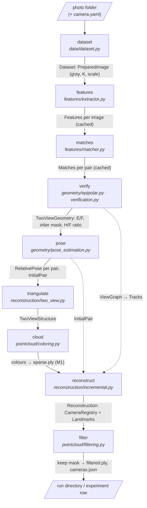
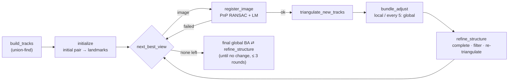

# Architecture & Conventions

This document shows how the pipeline is assembled and fixes the conventions every module must follow, so that geometry from different stages composes without sign or frame bugs. The module table is in the [README](../README.md#5-system-architecture); the maths behind each stage is in [methodology.md](methodology.md).

## Pipeline and data flow

`src.pipeline.run_pipeline(images, config, until=stage)` runs the stages in order; each reads and extends one `PipelineResult` and records its runtime. The CLI (`src/cli.py`) runs the pipeline up to a command's stage and writes every completed stage's outputs into a run directory; the experiment runner (`src/evaluation/experiments.py`) does the same for each setting of an experiment.

Inside `reconstruct`:

| Stage | Library entry point | CLI command | Main outputs |
|---|---|---|---|
| dataset | `prepare_dataset` | `validate` | `dataset.json` |
| features | `extract_features` | `features` | `features/` |
| matches | `match_pairs` | `matches` | `matches/` |
| verify | `verify_matches` | `verify` | `verification/` |
| pose | `estimate_pair_poses`, `initial_pair` | `pose` | `pose/` |
| triangulate | `build_two_view_structure` | `triangulate` | `triangulation/` |
| cloud | `color_points` | `two-view` | `point_clouds/sparse.ply`, `camera_poses/cameras.json`, renders |
| reconstruct | `reconstruct` | `reconstruct` | `reconstruction/`, `point_clouds/multi_view.ply` |
| filter | `filter_cloud` | `reconstruct` | `point_clouds/filtered.ply`, `figures/filtered.png` |

Stages fail softly: a pair that cannot be verified or posed, an image that cannot be registered, or a dataset without an initial pair produce results with a `reason`, not exceptions. Only an unusable image folder raises (`DatasetError`).

Features, matches and prepared images are cached under `outputs/cache/`, keyed by content and every setting that affects them, so experiment sweeps recompute only what a setting changes.

## Coordinate frames

| Item | Convention |
|---|---|
| World → camera | `x_c = R @ X + t` (`R` is 3×3 orthonormal, `det R = +1`) |
| Camera centre | `C = -R.T @ t` |
| Camera frame | `+x` right, `+y` down, `+z` forward (optical axis) — OpenCV convention |
| Projection | `x ~ K [R | t] X`, `P = K @ hstack([R, t[:, None]])` |
| Pixels | integer coordinates are pixel **centres** (OpenCV); `(0, 0)` is the centre of the top-left pixel; `x` = column, `y` = row |
| Image orientation | EXIF orientation is applied on load; sizes and `K` always refer to the upright image |
| Depth | camera-frame `z`; a point is valid only if `z > 0` in every camera observing it |
| Relative pose (i → j) | `R_ij = R_j @ R_i.T`, `t_ij = t_j - R_ij @ t_i` (maps camera-i coords to camera-j coords) |
| Essential / fundamental | `E = [t]x R`, `F = K_j^-T E K_i^-1`, constraint `x_j^T F x_i = 0` |

Two-view translation is recovered only up to scale; the first reconstruction fixes `||t|| = 1` and camera 0 at the origin with `R = I`. The multi-view reconstruction keeps that frame — the initial pair's image *i* at the origin, initial baseline 1 — and bundle adjustment preserves it (first camera fixed, scale restored after each adjustment). Comparisons with ground truth align by a similarity first.

## Array conventions

| Data | Shape | dtype |
|---|---|---|
| 3D points | `(N, 3)` | float64 |
| 2D points | `(N, 2)` | float64 (cast to float32 only at OpenCV call sites that require it) |
| Intrinsics `K` | `(3, 3)` | float64 |
| Rotations | `(3, 3)`; stacks `(M, 3, 3)` | float64 |
| Translations | `(3,)`; stacks `(M, 3)` | float64 |
| Images | `(H, W, 3)` BGR or `(H, W)` gray | uint8 |
| Colors for export | `(N, 3)` RGB in `[0, 1]` | float64 |

## Intrinsics and resizing

Resizing an image by `(sx, sy)` maps `fx → fx·sx`, `fy → fy·sy` and, because of the pixel-centre convention, `cx → (cx + 0.5)·sx − 0.5` (same for `cy`). `src.data.preprocessing.scale_intrinsics` implements this; every function that resizes must return the updated `K`. Never resize without it.

Estimated intrinsics put the principal point at the image centre `((w − 1)/2, (h − 1)/2)`. Intrinsics are resolved per image (calibration file → EXIF → fallback), so mixed-resolution folders are handled. Undistortion happens at the original resolution, before resizing; after it the distortion vector is zero.

## Configuration

All thresholds come from `configs/default.yaml` via `src.config.load_config()`. Each run saves its effective config next to its outputs. Unknown keys are errors.

## Testing ground truth

`tests/synthetic.py` builds scenes with known `K`, poses and 3D points using exactly these conventions. Geometry modules are tested against it before being run on real images.

## External components

Anything produced by COLMAP or other external tools is labelled as external in code (module docstring) and in reports.
