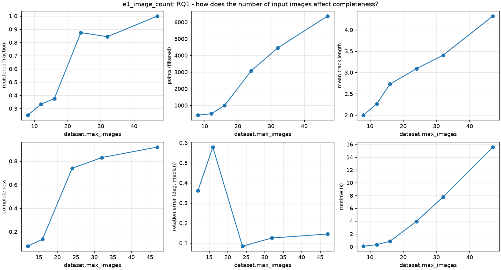
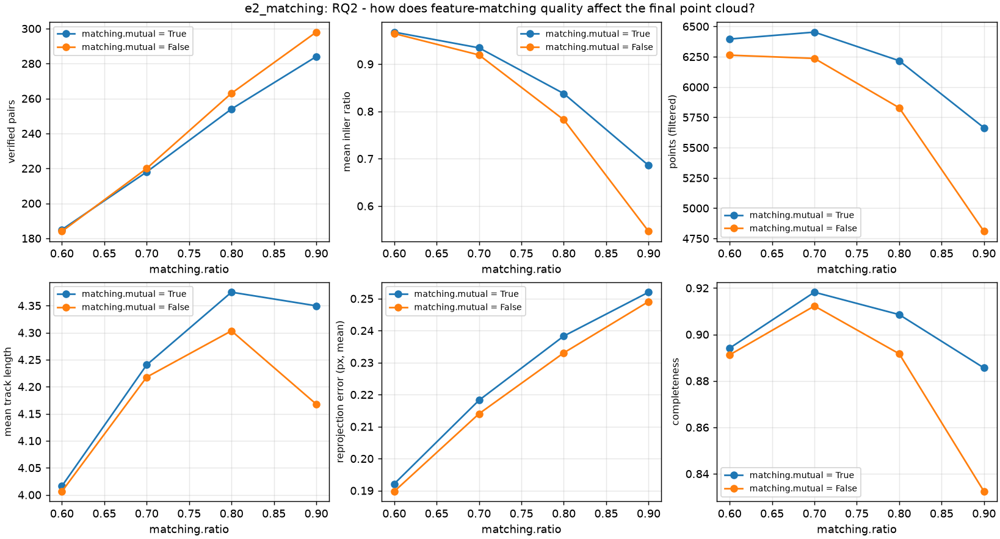
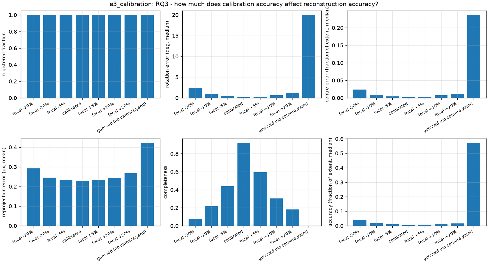
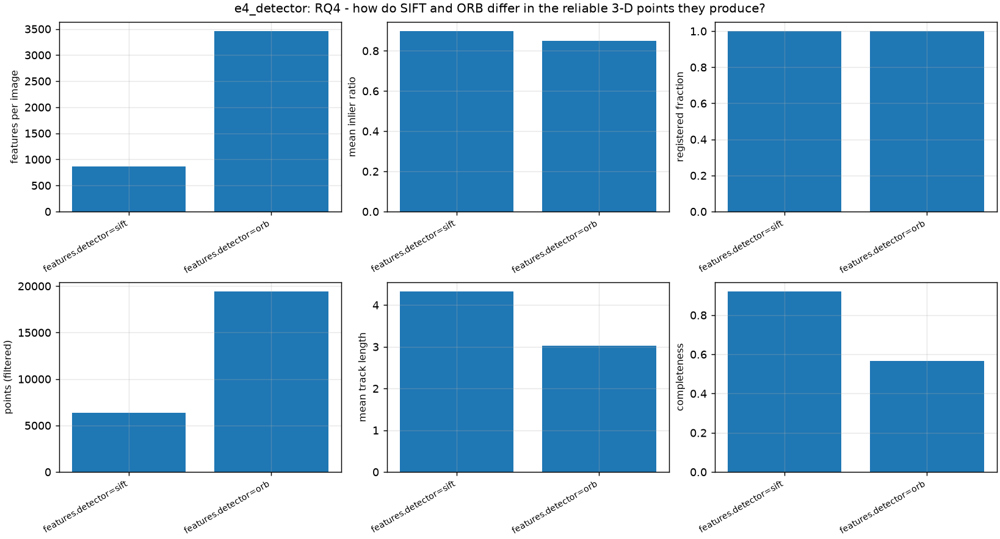
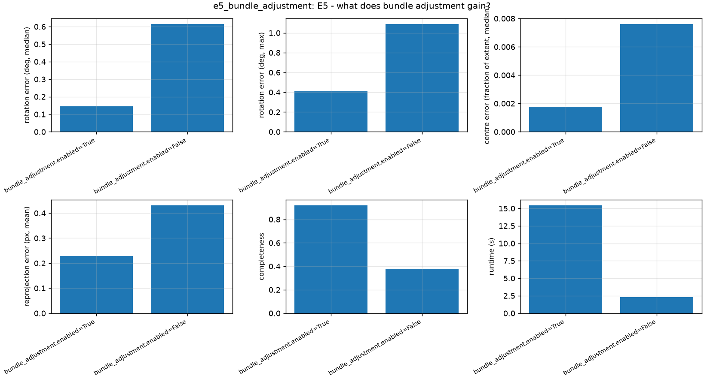
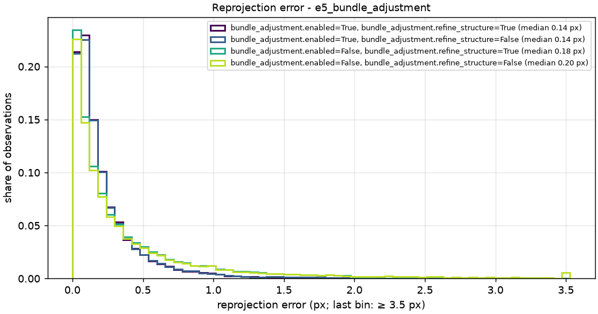
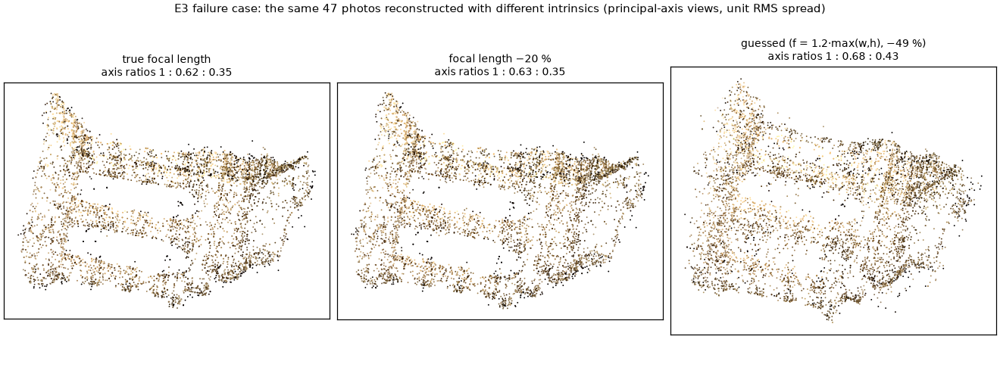

# Experiments (Phase 10)

Answers to the research questions on Middlebury **templeRing** (47 views, 640×480, ground-truth cameras). All numbers below regenerate with one command:

```bash
python scripts/download_middlebury.py templeRing     # once
python scripts/run_experiments.py                     # all specs in configs/experiments/, ~9 min on an Apple M4
python scripts/evaluate_results.py outputs/experiments/<run>   # redraw figures/tables only
```

Each experiment directory holds `experiment_results.csv` (one row per setting), `results.md`, `metrics.png`, `runtime.png`, and one sub-directory per run with its exact `config.yaml`, `environment.json`, `metrics.json` and `filtered.ply`. `notebooks/04_reconstruction_analysis.ipynb` loads the newest run.

## How runs are scored

| Metric | Definition |
|---|---|
| registered fraction | registered images / input images |
| inlier ratio | geometric inliers / matches, averaged over the pairs that passed verification (failed pairs excluded) |
| points (filtered) | landmarks in `filtered.ply` (after Phase 9 filtering) |
| mean track length | observations per landmark |
| reprojection error | mean over all observations, px — an internal consistency check, not accuracy |
| rotation / centre error | per camera, after the similarity that best maps our camera centres onto the true ones (Umeyama); centre error as a fraction of the camera ring's RMS radius |
| completeness | share of reference points with a reconstructed point within **1 %** of the reference's bounding-box diagonal (`evaluation.completeness_tolerance`) |
| accuracy | median distance from each reconstructed point to the nearest reference point, fraction of the diagonal |
| metric scale error | the scale from **one measured distance** (the true distance between the first two registered cameras), relative to the scale fitted over all cameras |

**Reference cloud (internal, not an external ground truth).** Middlebury does not publish the temple's ground-truth surface. The reference is every verified SIFT track over all 47 images, triangulated with the **ground-truth cameras** and filtered as a reconstruction would be: 6223 points. It is independent of our pose estimates but shares our features and matches, which has two consequences: (1) a run with fewer images cannot exceed the coverage of the full set; (2) *accuracy* favours SIFT runs, whose points sit on the same keypoints as the reference — compare detectors by completeness and pose error, not accuracy.

## Results

### E1 — image count (RQ1)

Subsets evenly spaced **in file-name order** (`dataset.max_images`). templeRing's file order is not angular order: consecutive images are mostly 7–8° apart, but the sequence jumps and sweeps about 540° (1.5 turns), so a subset covers the ring unevenly. The spacing column is the *median* angular gap between neighbouring views on the ring, measured from the ground-truth cameras; the largest gap is in brackets (even the full set leaves one 32° gap).

| images (median gap [max]) | registered | points | track length | completeness | rotation error |
|---|---|---|---|---|---|
| 8 (50° [78°]) | 2 | 413 | 2.0 | – | – |
| 12 (32° [65°]) | 4 | 499 | 2.3 | 0.08 | 0.36° |
| 16 (23° [40°]) | 6 | 997 | 2.7 | 0.14 | 0.58° |
| 24 (16° [32°]) | 21 | 3071 | 3.1 | 0.74 | 0.08° |
| 32 (8° [32°]) | 27 | 4450 | 3.4 | 0.83 | 0.13° |
| 47 (8° [32°]) | **47** | **6365** | **4.3** | **0.92** | 0.15° |



**RQ1:** completeness is limited by *view spacing*, not by image count as such. Between a median gap of 23° and 16° the reconstruction jumps from 6 to 21 registered images and from 14 % to 74 % completeness: SIFT matches on this plaster object barely survive verification beyond ~20° (Phase 4 saw 3 matches at 60°), so wider-spaced views never get enough 2D–3D links to register. Above that threshold, more images add points and longer tracks with diminishing returns (24 → 47 images: +18 points of completeness). Pose accuracy is already good once images register at all. Runtime grows superlinearly with image count (0.3 s → 15.6 s), mostly bundle adjustment.

### E2 — matching thresholds (RQ2)

| ratio | mutual | verified pairs | inlier ratio | points | completeness | reprojection |
|---|---|---|---|---|---|---|
| 0.6 | on | 185 | 0.97 | 6396 | 0.894 | 0.19 px |
| 0.7 | on | 218 | 0.93 | **6453** | **0.918** | 0.22 px |
| 0.8 | on | 254 | 0.84 | 6217 | 0.909 | 0.24 px |
| 0.9 | on | 284 | 0.69 | 5664 | 0.886 | 0.25 px |
| 0.9 | off | 298 | 0.55 | 4809 | 0.832 | 0.25 px |



**RQ2:** looser ratios verify more pairs but with lower inlier ratios, and the final cloud *shrinks* (6453 → 4809 points) and loses completeness (0.918 → 0.832): the extra matches are ambiguous ones, which lower inlier ratios and — our likely explanation, not measured separately — merge unrelated keypoints into tracks that the track builder then drops as inconsistent (two keypoints of one image). Too strict (0.6) loses tracks instead (track length 4.0 vs 4.4). The optimum is 0.7–0.8; the default 0.75 sits in it. The mutual check is nearly free at strict ratios and matters most at loose ones (+18 % points at 0.9). Every setting registers all 47 images — on this dataset matching quality decides cloud quality, not registration.

### E3 — calibration accuracy (RQ3)

| focal length | rotation error | centre error | completeness | accuracy | metric scale error | runtime |
|---|---|---|---|---|---|---|
| −20 % | 2.31° | 2.4 % | 0.08 | 4.1 % | +6.1 % | 41.5 s |
| −10 % | 0.94° | 0.9 % | 0.22 | 1.8 % | +1.7 % | 36.3 s |
| −5 % | 0.46° | 0.5 % | 0.44 | 1.1 % | +0.1 % | 28.3 s |
| **true** | **0.15°** | **0.2 %** | **0.92** | **0.45 %** | −0.7 % | 15.4 s |
| +5 % | 0.28° | 0.3 % | 0.59 | 0.8 % | −1.3 % | 18.3 s |
| +10 % | 0.69° | 0.7 % | 0.31 | 1.2 % | −2.5 % | 24.8 s |
| +20 % | 1.23° | 1.2 % | 0.18 | 1.6 % | −3.5 % | 41.5 s |
| guessed (−49 %) | 20.0° | 24 % | 0.00 | 57 % | +84 % | 29.0 s |



**RQ3:** calibration is the single most important input. Every setting registers all 47 images and the reprojection error barely moves (0.23 → 0.29 px at −20 %) — **a wrong focal length is invisible in the internal diagnostics** — yet the geometry degrades steadily: a 5 % focal error halves completeness, 10 % leaves a quarter, and the fallback guess (`f = 1.2·max(w, h)` = 768 px vs the true 1520 px) produces a distorted model (20° rotation error, nothing within tolerance of the reference). A wrong focal length stretches depth relative to width, a distortion no similarity transform removes. Bundle adjustment also works harder (15 → 41 s) to absorb the inconsistency. Implication: calibrate the camera (`python -m src.cli calibrate`), or extend bundle adjustment to refine the focal length — today it keeps K fixed.

### E4 — SIFT vs ORB (RQ4)

| detector | features/image | inlier ratio | points | track length | completeness | rotation error | reprojection | runtime |
|---|---|---|---|---|---|---|---|---|
| SIFT | 869 | 0.90 | 6365 | 4.3 | **0.92** | **0.15°** | **0.23 px** | **15.5 s** |
| ORB | 3460 | 0.85 | 19409 | 3.0 | 0.57 | 0.58° | 0.42 px | 64.5 s |



Neither detector reaches the 8000-feature cap: SIFT's contrast threshold keeps ~870 features per image on the smooth plaster (every templeRing image is above the 500-feature target, so the adaptive threshold never lowers it here), ORB's FAST detector ~3500. **RQ4:** ORB yields 3× more points but shorter tracks and less reliable ones — 4× the pose error, nearly twice the reprojection error and much lower completeness (0.57 vs 0.92) despite the denser cloud; its binary descriptors are less distinctive and its keypoints less precisely localised. It is also 4× slower overall, because the extra features make matching (11 s vs 0.2 s) and bundle adjustment (50 s vs 14 s) more expensive. SIFT is the right default; ORB's only advantage on this data is raw point count. (Phase 2 measured ORB failing entirely on blurred images, where SIFT still found 265 features.)

### E5 — bundle adjustment and structure refinement

Both switched independently (`bundle_adjustment.enabled`, `bundle_adjustment.refine_structure`); refinement = re-attach track keypoints that fit, drop observations beyond 2 px, re-triangulate, after every registration.

| bundle adjustment | refinement | rotation error (median / max) | centre error | reprojection (mean) | observations > 2 px | completeness | runtime |
|---|---|---|---|---|---|---|---|
| on | on | **0.15° / 0.41°** | **0.18 %** | **0.23 px** | **0** | **0.92** | 15.6 s |
| on | off | 0.17° / 0.47° | 0.19 % | 0.25 px | 0.52 % (max 5.7 px) | 0.92 | 14.8 s |
| off | on | 0.62° / 1.09° | 0.76 % | 0.34 px | 0 | 0.38 | 2.7 s |
| off | off | 0.62° / 1.09° | 0.76 % | 0.43 px | 3.82 % (max 4.0 px) | 0.38 | 2.3 s |



**Bundle adjustment does the work:** it cuts pose errors 4× and raises completeness from 0.38 to 0.92 — without it, small PnP errors accumulate around the ring — at nearly 90 % of the runtime. **Refinement is a cleaning step:** it removes every observation beyond 2 px (without it, 0.5 % remain with bundle adjustment and 3.8 % without — mostly PnP links accepted at 4 px), which lowers the reprojection error and, by giving bundle adjustment cleaner input, trims pose errors by ~12 % (0.17° → 0.15° median, 0.47° → 0.41° max). Alone it cannot move cameras, so without bundle adjustment the poses and completeness are unchanged.



### Metric scale from one measured distance

A monocular reconstruction has no scale; one known distance sets it (`evaluation.metrics.metric_scale`). Using the true distance between two neighbouring cameras, the resulting scale agrees within **0.7 %** with the scale fitted over all 47 cameras for the default pipeline (within 1.5 % for every E1/E2 setting that registers ≥ 3 cameras), 5.6 % without bundle adjustment, and 84 % off with guessed intrinsics. This is a consistency check — both scales come from the same reconstruction and ground truth — not an independent measurement; with a real tape-measured distance its accuracy is also bounded by the measurement. A longer reference distance (e.g. across the object) averages out more local error.

### RQ5 — sparse vs dense: future work

E6 (our sparse reconstruction vs COLMAP's sparse and dense reconstructions on the same images) was not run: it needs COLMAP (`brew install colmap`), and the optional dense stage of Phase 9 was left out of scope. What the sparse results already show about the limits of sparse reconstruction: 6365 points on the temple are enough to recover the cameras to 0.15° and the object's layout, but not a surface — points exist only where SIFT finds distinctive features, so the renders show gaps and uneven density across the plaster, and 35 % of landmarks are seen in only two images. A dense stage (COLMAP patch-match stereo on our poses, then Poisson meshing) is the natural next step; see README §16.

## Failure cases

| Case | What happens | Why | Evidence |
|---|---|---|---|
| **Views too far apart** | 8 views ~50° apart: only the initial pair registers (2/8); 16 views ~23° apart: 6/16 | SIFT on smooth plaster stops matching beyond ~20°; with no verified pairs there are no 2D–3D links for PnP | E1; Phase 4: 3 matches at 60° on rendered views |
| **Wrong focal length** | Every image registers, reprojection error stays ~0.25 px, but completeness falls to 0.44 (−5 %) and 0.08 (−20 %) | A wrong `K` stretches depth against width — a distortion no similarity removes and bundle adjustment (fixed `K`) cannot absorb; the internal diagnostics do not notice | E3, figure below |
| **No calibration at all** | 20° rotation error, 24 % centre error, completeness 0 | Fallback `f` = 768 px vs the true 1520 px (−49 %); the essential-matrix path is skipped, and poses from `F` with a wrong `K` are badly biased | E3 |
| **Dark, low-texture images** (fixed SIFT threshold) | dinoRing: 19/48 cameras registered — the brightly lit side only | SIFT's absolute contrast threshold left the dark side 74–160 features; PnP ran out of 2D–3D links at both edges. **Fixed:** the threshold is lowered per image below 500 features (48/48, rotation error median 0.15°) | `data/sample/README.md`, `tests/test_features.py` |
| **ORB on low texture** | 3× the points but 4× the pose error, short tracks | less distinctive binary descriptors and less precise keypoints | E4 |
| **No bundle adjustment** | pose errors 4× larger, completeness 0.38 (with or without refinement) | small PnP errors accumulate around the ring; refinement cleans observations but cannot move cameras | E5 |
| **Undetectable wrong matches** | ~1 % of deliberately shifted keypoints survive in the final model | a shift along the epipolar line of a 2–3-view track leaves no reprojection error | `tests/test_incremental.py` |



The −20 % cloud (middle) looks like the calibrated one (left) to the eye — the same proportions — although its completeness is 0.08 instead of 0.92: the damage is a few percent of the object's size per point, everywhere. Only the ground-truth comparison reveals it. The guessed intrinsics (right) visibly thicken the model (axis ratios 1 : 0.68 : 0.43 instead of 1 : 0.62 : 0.35).

## Limits of these experiments

- One dataset, one object (plaster, black background, a ring of views). Conclusions about view spacing and detector choice are specific to such low-texture objects.
- The reference shares our SIFT features and matches; it measures geometry given the tracks, not against an independent surface scan.
- Each setting runs once. The pipeline is deterministic (seeded RANSAC), so repeats give identical numbers; variation across datasets is not measured.
