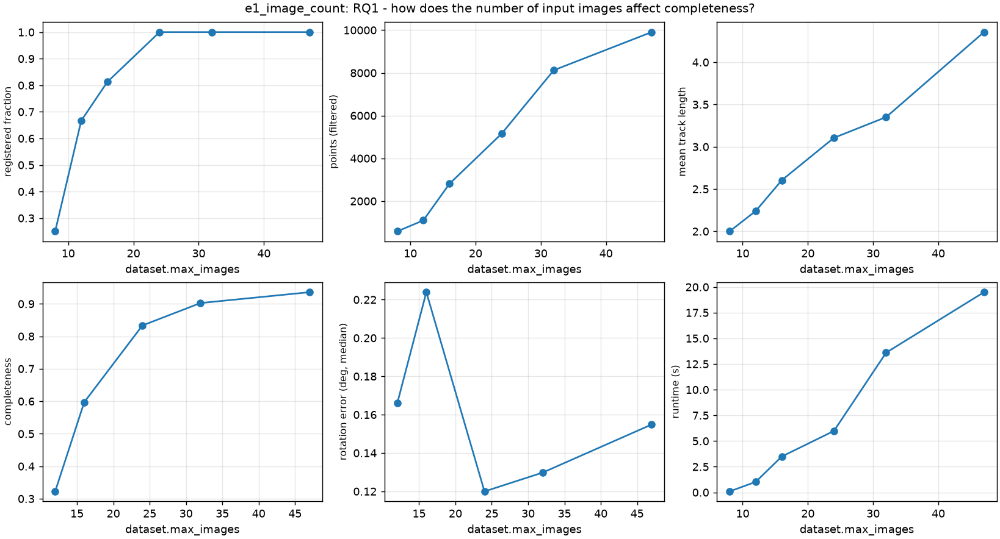
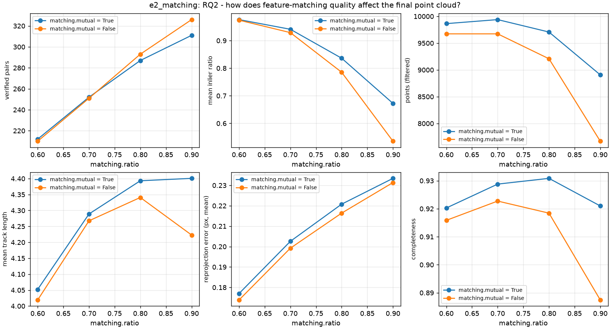
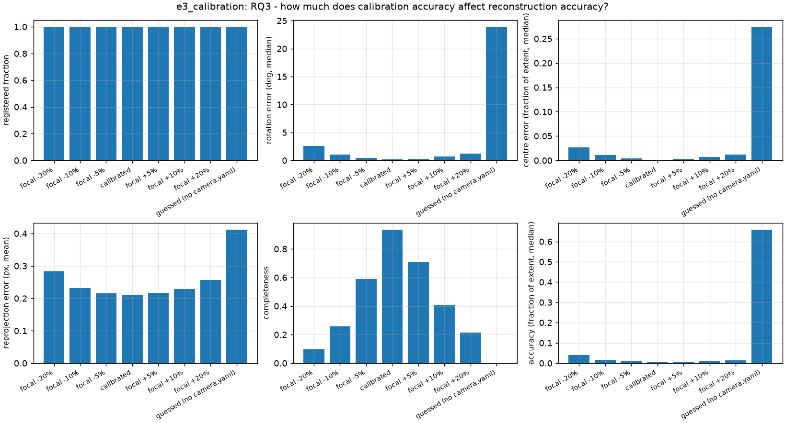
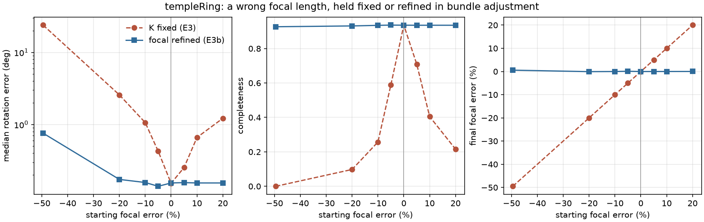
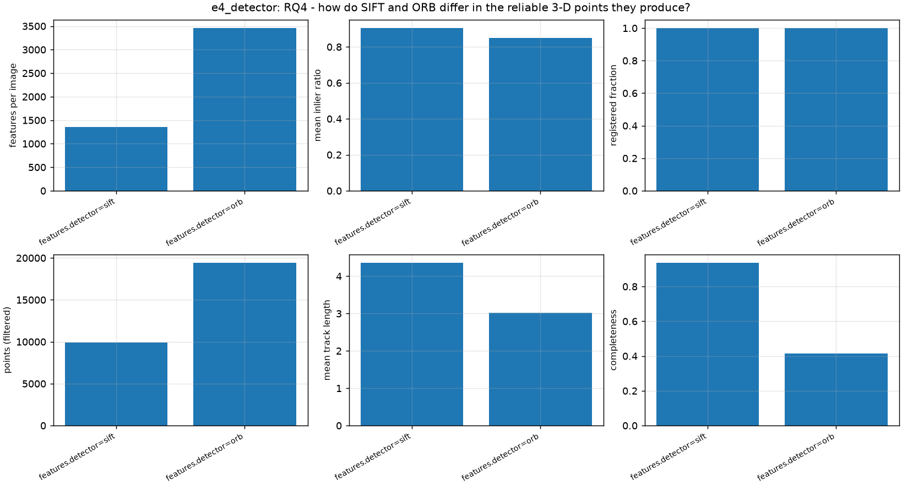
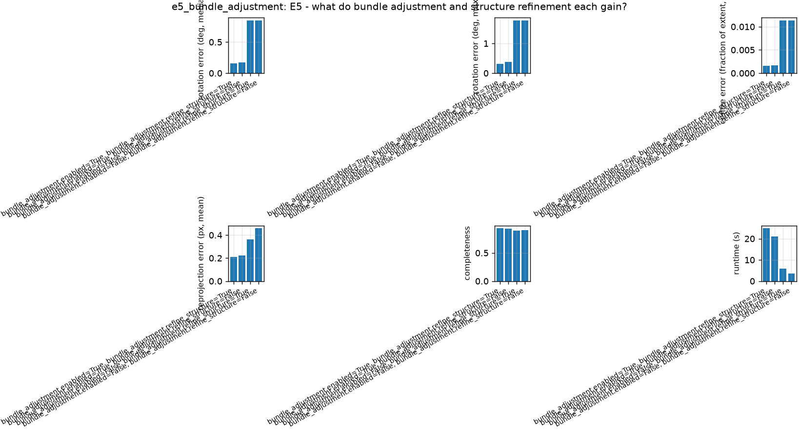
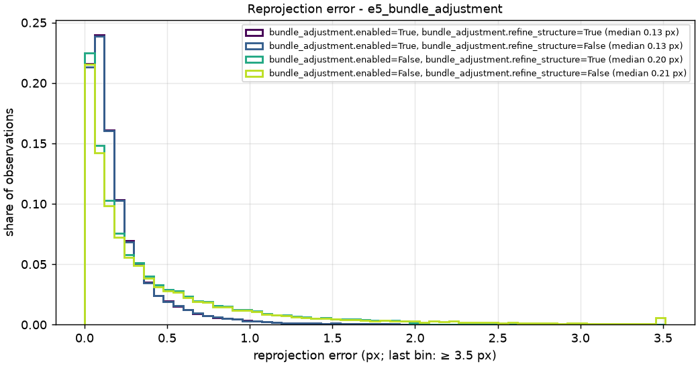
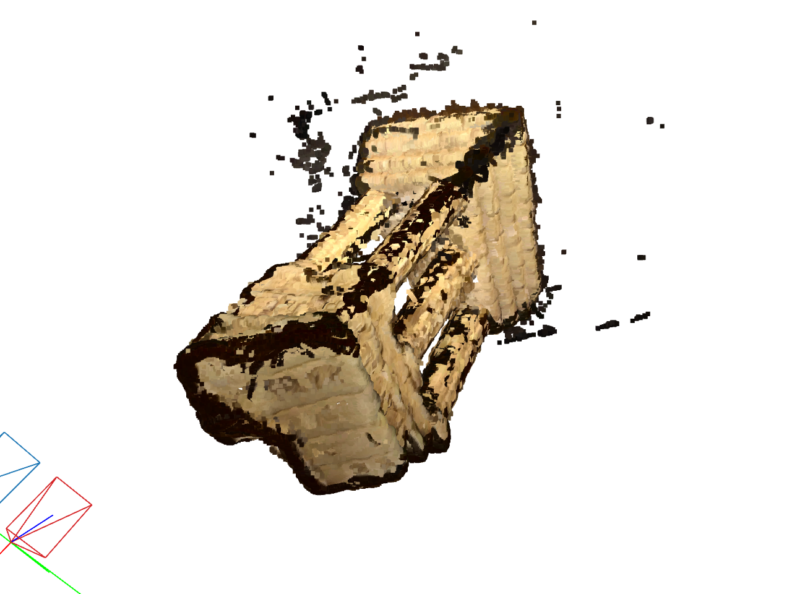
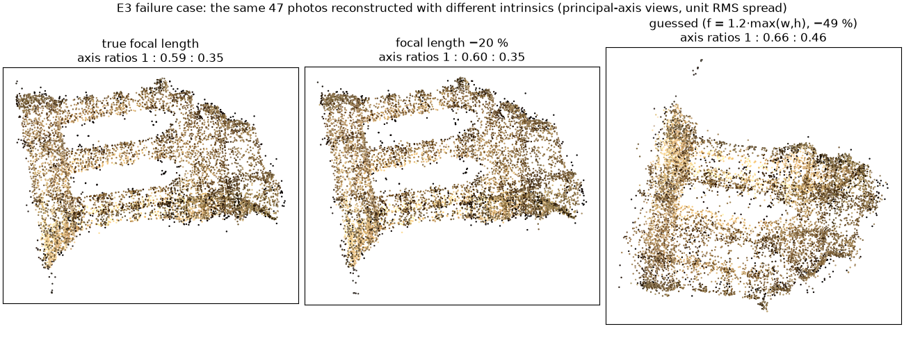

# Experiments (Phase 10)

Answers to the research questions on Middlebury **templeRing** (47 views, 640×480, ground-truth cameras). All numbers below regenerate with one command:

```bash
python scripts/download_middlebury.py templeRing     # once
python scripts/run_experiments.py                     # all specs in configs/experiments/, ~14 min on an Apple M4
python scripts/evaluate_results.py outputs/experiments/<run>   # redraw figures/tables only
```

Each experiment directory holds `experiment_results.csv` (one row per setting), `results.md`, `metrics.png`, `runtime.png`, and one sub-directory per run with its exact `config.yaml`, `environment.json`, `metrics.json` and `filtered.ply`. `notebooks/04_reconstruction_analysis.ipynb` loads the newest run.

## How runs are scored

| Metric | Definition |
|---|---|
| registered fraction | registered images / input images |
| inlier ratio | geometric inliers / matches, averaged over the pairs that passed verification (failed pairs excluded) |
| points (filtered) | landmarks in `filtered.ply` (after Phase 9 filtering) |
| mean track length | observations per landmark |
| reprojection error | mean over all observations, px — an internal consistency check, not accuracy |
| rotation / centre error | per camera, after the similarity that best maps our camera centres onto the true ones (Umeyama); centre error as a fraction of the camera ring's RMS radius |
| completeness | share of reference points with a reconstructed point within **1 %** of the reference's bounding-box diagonal (`evaluation.completeness_tolerance`) |
| accuracy | median distance from each reconstructed point to the nearest reference point, fraction of the diagonal |
| metric scale error | the scale from **one measured distance** (the true distance between the first two registered cameras), relative to the scale fitted over all cameras |

**Reference cloud (internal, not an external ground truth).** Middlebury does not publish the temple's ground-truth surface. The reference is every verified SIFT track over all 47 images, triangulated with the **ground-truth cameras** and filtered as a reconstruction would be: 9745 points. It is independent of our pose estimates but shares our features and matches, which has two consequences: (1) a run with fewer images cannot exceed the coverage of the full set; (2) *accuracy* favours SIFT runs, whose points sit on the same keypoints as the reference — compare detectors by completeness and pose error, not accuracy.

## Results

### E1 — image count (RQ1)

Subsets evenly spaced **in file-name order** (`dataset.max_images`). templeRing's file order is not angular order: consecutive images are mostly 7–8° apart, but the sequence jumps and sweeps about 540° (1.5 turns), so a subset covers the ring unevenly. The spacing column is the *median* angular gap between neighbouring views on the ring, measured from the ground-truth cameras; the largest gap is in brackets (even the full set leaves one 32° gap).

| images (median gap [max]) | registered | points | track length | completeness | rotation error |
|---|---|---|---|---|---|
| 8 (50° [78°]) | 2 | 583 | 2.0 | – | – |
| 12 (32° [65°]) | 8 | 1098 | 2.2 | 0.32 | 0.17° |
| 16 (23° [40°]) | 13 | 2810 | 2.6 | 0.60 | 0.22° |
| 24 (16° [32°]) | **24** | 5154 | 3.1 | 0.83 | 0.12° |
| 32 (8° [32°]) | **32** | 8125 | 3.4 | 0.90 | 0.13° |
| 47 (8° [32°]) | **47** | **9907** | **4.4** | **0.94** | 0.16° |



**RQ1:** completeness is limited by *view spacing*, not by image count as such. Every image registers once the median gap is 16° or less; at 23° three of 16 drop out (completeness 0.60), at 32° four of 12 (0.32), and at 50° only the initial pair remains. Wider-spaced views share too few verified matches, so they never get enough 2D–3D links to register. With OpenCV's default SIFT contrast threshold (0.04, our default before the ETH3D scenes, see E7) the cliff was sharper: 6 of 16 and 4 of 12 registered — the lower threshold (0.02) gives more, weaker features that keep wider pairs matchable. Above full registration, more images add points and longer tracks with diminishing returns (24 → 47 images: completeness 0.83 → 0.94). Pose accuracy is already good once images register at all. Runtime grows superlinearly with image count (0.1 s → 19.5 s), mostly bundle adjustment.

### E2 — matching thresholds (RQ2)

| ratio | mutual | verified pairs | inlier ratio | points | completeness | reprojection |
|---|---|---|---|---|---|---|
| 0.6 | on | 212 | 0.98 | 9864 | 0.920 | 0.18 px |
| 0.7 | on | 252 | 0.94 | **9939** | 0.929 | 0.20 px |
| 0.8 | on | 287 | 0.84 | 9707 | **0.931** | 0.22 px |
| 0.9 | on | 311 | 0.67 | 8907 | 0.921 | 0.23 px |
| 0.9 | off | 326 | 0.54 | 7668 | 0.887 | 0.23 px |



**RQ2:** looser ratios verify more pairs but with lower inlier ratios, and past 0.8 the final cloud *shrinks* (9939 → 7668 points) and loses completeness (0.931 → 0.887): the extra matches are ambiguous ones, which lower inlier ratios and — our likely explanation, not measured separately — merge unrelated keypoints into tracks that the track builder then drops as inconsistent (two keypoints of one image). Too strict (0.6) loses tracks instead (track length 4.05 vs 4.4). The optimum is 0.7–0.8; the default 0.75 sits in it. The mutual check is nearly free at strict ratios and matters most at loose ones (+16 % points at 0.9). Every setting registers all 47 images — on this dataset matching quality decides cloud quality, not registration.

### E3 — calibration accuracy (RQ3)

| focal length | rotation error | centre error | completeness | accuracy | metric scale error | runtime |
|---|---|---|---|---|---|---|
| −20 % | 2.58° | 2.7 % | 0.10 | 4.1 % | +4.9 % | 58.3 s |
| −10 % | 1.06° | 1.1 % | 0.26 | 1.7 % | +2.2 % | 22.7 s |
| −5 % | 0.43° | 0.4 % | 0.59 | 0.9 % | +2.0 % | 23.2 s |
| **true** | **0.15°** | **0.15 %** | **0.94** | **0.44 %** | +1.9 % | 16.7 s |
| +5 % | 0.25° | 0.3 % | 0.71 | 0.7 % | +1.9 % | 22.9 s |
| +10 % | 0.66° | 0.7 % | 0.41 | 1.0 % | +1.7 % | 33.6 s |
| +20 % | 1.22° | 1.2 % | 0.22 | 1.4 % | +1.6 % | 53.3 s |
| guessed (−49 %) | 23.9° | 28 % | 0.00 | 66 % | +91 % | 44.2 s |



**RQ3:** calibration is the single most important input. Every setting registers all 47 images and the reprojection error barely moves (0.21 → 0.28 px at −20 %) — **a wrong focal length is invisible in the internal diagnostics** — yet the geometry degrades steadily: a 5 % focal error costs a quarter to a third of the completeness (0.94 → 0.59–0.71), 10 % more than half, and the fallback guess (`f = 1.2·max(w, h)` = 768 px vs the true 1520 px) produces a distorted model (24° rotation error, nothing within tolerance of the reference). A wrong focal length stretches depth relative to width, a distortion no similarity transform removes. Bundle adjustment also works harder (17 → 58 s) to absorb the inconsistency. Implication: calibrate the camera (`python -m src.cli calibrate`), or refine the focal length in bundle adjustment — which E3b does. (E3 pins `bundle_adjustment.refine_focal: false` so this table stays reproducible.)

### E3b — refining the focal length in bundle adjustment (RQ3)

The E3 sweep again, with `bundle_adjustment.refine_focal` on (the default): every global adjustment also refines one focal scale shared by all images (methodology §8). True `fx` = 1520.4 px.

| starting focal length | refined focal length | rotation error | centre error | completeness | accuracy | metric scale error | runtime |
|---|---|---|---|---|---|---|---|
| −20 % … +20 % (6 runs) | 1519.4–1521.9 px (−0.06…+0.10 %) | 0.14–0.17° | 0.15–0.17 % | 0.93–0.94 | 0.44–0.47 % | −1.2…+1.9 % | 19–26 s |
| **true** | 1520.2 px (−0.02 %) | **0.16°** | **0.15 %** | **0.94** | **0.44 %** | +1.9 % | 20.0 s |
| guessed (−49 %, 768 px) | 1529.2 px (+0.58 %) | 0.76° | 0.18 % | 0.93 | 0.52 % | −1.7 % | 23.3 s |



*Drawn by `python scripts/plot_focal_refinement.py <run>/e3_calibration <run>/e3b_focal_refinement`.*

**RQ3, revisited:** with the focal length refined, every starting error from −20 % to +20 % converges to within 0.1 % of the true focal length and to the same result as the true calibration — completeness 0.93–0.94 instead of 0.10–0.71, rotation error 0.14–0.17° instead of up to 2.6°, and BA no longer slows down (19–26 s instead of up to 58 s). On the true calibration it changes nothing measurable (0.02 % focal drift, same pose and cloud errors). Even the fallback guess, half the true focal length, now gives a usable model: 0.93 completeness instead of 0.00, 0.76° instead of 24°.

The guess's remaining 0.76° is a near-constant rotation offset (the camera centres are as accurate as with the true `K`, 0.18 %): consistent with its principal point, which stays at the image centre (320, 240) while the calibrated one is (302.3, 246.9) — a 19 px shift is 0.72° at f = 1520 px. Refining the principal point too was measured (`python scripts/principal_point_study.py data/raw/templeRing calibrated|guessed`: one extra global adjustment with a principal-point offset shared by all images). From the guess it more than halves the rotation error, 0.76° → 0.31°, but moves the principal point only part of the way, (319.5, 239.5) → (306.9, 243.7) against the true (302.3, 246.9); from the true calibration it drifts 1.9 px and makes the rotation error worse, 0.155° → 0.186°. On a ring of views looking inwards a principal-point shift is almost exactly a small rotation of every camera, so the data pin it down only weakly. It stays fixed: refining it would cost calibrated runs and only partly repair guessed ones — a calibration file remains the fix.

Why the focal length is observable here: the ring spans 360° and the scene has depth relative to its distance, so the wrong focal length's stretch of depth against width cannot be absorbed by the poses. On synthetic tests the same holds down to 3 cameras over 20° (focal within 0.2 %); with fewer views or a nearly planar scene it would be ill-conditioned, so local adjustments (5 cameras) keep `K` fixed.

### E4 — SIFT vs ORB (RQ4)

| detector | features/image | inlier ratio | points | track length | completeness | rotation error | reprojection | runtime |
|---|---|---|---|---|---|---|---|---|
| SIFT | 1360 | 0.90 | 9907 | 4.4 | **0.94** | **0.16°** | **0.21 px** | **20.5 s** |
| ORB | 3460 | 0.85 | 19404 | 3.0 | 0.41 | 0.91° | 0.42 px | 45.7 s |



Neither detector reaches the 8000-feature cap: SIFT's contrast threshold keeps ~1360 features per image on the smooth plaster (every templeRing image is above the 500-feature target, so the adaptive threshold never lowers it here), ORB's FAST detector ~3500. **RQ4:** ORB yields twice the points but shorter tracks and less reliable ones — 6× the pose error, twice the reprojection error and less than half the completeness (0.41 vs 0.94) despite the denser cloud; its binary descriptors are less distinctive and its keypoints less precisely localised. It is also twice as slow overall, because the extra points make bundle adjustment more expensive (reconstruction 42 s vs 17 s; features and matches came from the cache in both runs). SIFT is the right default; ORB's only advantage on this data is raw point count. (Phase 2 measured ORB failing entirely on blurred images, where SIFT still found 265 features.)

### E5 — bundle adjustment and structure refinement

Both switched independently (`bundle_adjustment.enabled`, `bundle_adjustment.refine_structure`); refinement = re-attach track keypoints that fit, drop observations beyond 2 px, re-triangulate, after every registration.

| bundle adjustment | refinement | rotation error (median / max) | centre error | reprojection (mean) | observations > 2 px | completeness | runtime |
|---|---|---|---|---|---|---|---|
| on | on | **0.16° / 0.32°** | **0.15 %** | **0.21 px** | **0** | **0.94** | 24.9 s |
| on | off | 0.17° / 0.37° | 0.17 % | 0.22 px | 0.35 % (max 4.1 px) | 0.93 | 21.1 s |
| off | on | 0.85° / 1.78° | 1.1 % | 0.36 px | 0 | 0.90 | 5.9 s |
| off | off | 0.85° / 1.78° | 1.1 % | 0.46 px | 4.1 % (max 4.0 px) | 0.90 | 3.6 s |



**Bundle adjustment does the work:** it cuts pose errors 5.5× — without it, small PnP errors accumulate around the ring — and raises completeness from 0.90 to 0.94, at about 75 % of the runtime. (With OpenCV's default SIFT threshold, completeness without bundle adjustment was only 0.38: the denser features give PnP more links per image, so the unadjusted poses drift less.) **Refinement is a cleaning step:** it removes every observation beyond 2 px (without it, 0.35 % remain with bundle adjustment and 4.1 % without — mostly PnP links accepted at 4 px), which lowers the reprojection error and, by giving bundle adjustment cleaner input, trims pose errors by ~10 % (0.17° → 0.16° median, 0.37° → 0.32° max). Alone it cannot move cameras, so without bundle adjustment the poses and completeness are unchanged.



### Metric scale from one measured distance

A monocular reconstruction has no scale; one known distance sets it (`evaluation.metrics.metric_scale`). Using the true distance between two neighbouring cameras, the resulting scale agrees within **1.9 %** with the scale fitted over all 47 cameras for the default pipeline (within 2.1 % for every E1/E2 setting that registers ≥ 3 cameras), 1.0 % without bundle adjustment, and 91 % off with guessed intrinsics. That the run without bundle adjustment scores better shows the limit of this check: one short camera-to-camera distance carries its two cameras' local error, so the agreement is only good to a few per cent either way. It is a consistency check — both scales come from the same reconstruction and ground truth — not an independent measurement; with a real tape-measured distance its accuracy is also bounded by the measurement. A longer reference distance (e.g. across the object) averages out more local error.

### E6 — COLMAP baseline and dense reconstruction (RQ5)

**Sparse: ours vs COLMAP (external).** `python scripts/run_colmap_baseline.py data/raw/<set> [--fix-intrinsics]` runs COLMAP 4.2.1 (CPU SIFT, exhaustive matching, incremental mapper) on the images our pipeline prepared, with the same starting `K`; both are aligned to the ground-truth cameras by a similarity. "COLMAP" refines its focal length (its default, like ours); "COLMAP, K fixed" holds it at the calibrated value.

| | templeRing ours | COLMAP | COLMAP, K fixed | dinoRing ours | COLMAP | COLMAP, K fixed | dinoSparseRing ours | COLMAP, K fixed |
|---|---|---|---|---|---|---|---|---|
| registered | **47/47** | 47/47 | 47/47 | **48/48** | 24/48 | 24/48 | 6/16 | 6/16 |
| rotation error median / max (°) | **0.15** / 0.32 | 0.26 / 0.51 | 0.18 / 0.43 | **0.15** / 0.30 | 23.4 / 24.7 | 0.85 / 2.18 | **0.19** / 0.37 | 0.54 / 0.76 |
| centre error (median, fraction of extent) | **0.15 %** | 0.20 % | 0.19 % | **0.24 %** | 3.0 % | 0.79 % | 0.52 % | **0.42 %** |
| final focal length (px; true 1520 / 3310) | 1520 | 1528 | (1520) | 3248 | 1244 | (3310) | 3240 | (3310) |
| points | 9907 | 7603 | 7607 | 3462 | 496 | 494 | 433 | 175 |
| mean reprojection error (px) | 0.18 | 0.29 | 0.29 | 0.39 | 0.78 | 0.79 | 0.33 | 0.65 |
| time (s) | 21 | 13 | 7 | 22 | 5 | 4 | 0.8 | 1.4 |

(COLMAP is not fully deterministic on the CPU: repeated runs move its errors by a few hundredths of a degree.)

On templeRing both systems recover every camera and our poses are slightly more accurate, at about twice COLMAP's run time. On dinoRing COLMAP's default SIFT finds a median 237 features per image against our 737 (our contrast threshold adapts to dark images, Phase 2), so it registers only the bright half; with its focal length free, that half also drifts to f = 1251 px (−62 %) and 23° errors — the failure our `max_focal_change` guard prevents. On dinoSparseRing both stop at the same 6 images, which supports the conclusion that the remaining views lack the overlap to be registered, not our registration logic. COLMAP's parameters could be tuned (e.g. its SIFT peak threshold); the table uses its defaults except a PINHOLE camera with our starting `K` and our feature cap (8000). The ETH3D scenes are compared in E7. Our focal refinement lands 1.9 % low on dinoRing (3248 vs 3310 px) with the poses still at 0.15°: on a ring of views the focal length and the ring's distance trade off.

**Dense: our sparse vs our dense.** `python -m src.cli dense` adds a depth map per registered image (rectified stereo with the view nearest 8° away, `cv2.StereoSGBM`), fused by multi-view depth consistency. Neither dataset has a public ground-truth surface, so `python scripts/evaluate_dense.py` uses the black background instead: a true surface point projects inside the object's silhouette in every view, and the fraction that lands on background somewhere counts outliers (silhouettes: grey > 15, dilated 2 px; shaded plaster also falls below the threshold, so even the sparse cloud scores a few per cent).

| | points | outside a silhouette | time (s) | pixels with a depth (median) |
|---|---|---|---|---|
| templeRing sparse | 9 907 | 3.1 % | 19.8 | — |
| templeRing dense | 1 840 449 | **0.8 %** | +1.3 | 20 % |
| dinoRing sparse | 3 462 | 10.2 % | 21.9 | — |
| dinoRing dense | 707 114 | **5.8 %** | +0.8 | 10 % |



The settings were chosen on templeRing by this measure (with the sparse cloud of OpenCV's default SIFT threshold, before E7; the dense numbers above use the current default): an SGBM block of 3 px (larger blocks fatten object edges: 7.6 % outside with a 7 px block, 6.4 % with 5 px and a texture threshold of 1.5), no depth where the grey levels' standard deviation in the block is below 2 (uniform background matches anywhere: without this mask the black background around the temple became a wall of points, 5 M in all), rectification that keeps every pixel (`alpha` 0 crops the image borders: 61 % instead of 87 % of the true depths on rendered views). Requiring 3 confirming views instead of 2 removed fewer outliers (4.5 %) than the block size did. A view whose depth map came from stereo with the checked view is never one of its checks (it would repeat the same matching errors): 2.0 % → 1.9 %. Of the remaining off-silhouette points, almost all lay within 2–5 px of a silhouette (edge fattening: 2.5 % beyond 2 px in some view, 0.09 % beyond 10 px), so each depth map drops a 1 px band around every pixel without a depth (`edge_erosion_px`): 1.9 % → 0.8 %, far scatter (> 10 px) 0.09 % → 0.01 %, for 19 % fewer points. A 2 px band gained little more (0.7 %) for another 23 % of the points; detecting depth jumps explicitly added nothing, and a photometric check in fusion (grey levels within 10–40 at the projections) only reached 1.6 % while dropping up to 18 % of the points. On dinoRing the band costs 40 % of the points (its depth maps are fragmented) for 6.2 % → 5.8 %; the dark dino itself falls partly below the silhouette threshold, so this measure is noisier there.

**RQ5:** sparse reconstruction is enough to recover the cameras — 0.15°, better than COLMAP here — but 10 k points are not a surface: they exist only where SIFT finds distinctive features. Dense stereo on the same cameras gives 190× the points in a few seconds and covers the textured surface, with fewer outliers by the silhouette measure. Its limits are different ones: uniform regions get no depth at all, edges fatten in stereo (background next to the object takes its depth; a 1 px band around every gap removes most of it), and a little isolated scatter remains that the sparse outlier filters are too slow to remove at millions of points; the Poisson mesh then closes holes by extrapolation. Dense quality also rests entirely on the sparse cameras: rendered views with exact cameras give a median depth error of 0.1–0.3 %.

### E7 — other datasets: ETH3D (generalisation)

Middlebury's objects sit on a black background in a ring of views. ETH3D's high-resolution multi-view benchmark has real indoor and outdoor scenes photographed with a DSLR (6220 × 4141, undistorted; our preprocessing works at 1600 px) and laser-scan-registered ground-truth cameras (Schöps et al., CVPR 2017). `python scripts/download_eth3d.py <scene>` (needs the `data` extra, py7zr) writes the images, `camera.yaml` and `gt_cameras.json`; the evaluation scripts then work unchanged. Three training scenes: **pipes** (14 images, an industrial pipe close-up), **office** (26, indoor, low texture), **terrains** (42, a sand table with toy terrain).

| scene | OpenCV's SIFT threshold (0.04) | **default (0.02)** | COLMAP (external) | COLMAP, K fixed |
|---|---|---|---|---|
| pipes: registered, rotation error median / max | 7/14, 0.16° / 0.24° | **14/14, 0.06° / 0.12°** | 11/14, 0.08° / 0.12° | 11/14, 0.07° / 0.16° |
| office | 25/26, 0.27° / 0.49° | **26/26, 0.14° / 0.35°** | 26/26, 0.24° / 0.38° | 26/26, 0.14° / 0.28° |
| terrains | 30/42, 0.24° / 0.33° | **42/42, 0.18° / 0.22°** | not run¹ | not run¹ |

¹ terrains' undistorted images come in two heights (4141 and 4144 px), so after resizing their intrinsics differ by 0.2 %: the baseline script runs COLMAP with one shared camera and refuses mixed intrinsics (our pipeline also skips focal refinement there for the same reason).

With OpenCV's default contrast threshold (0.04, our default until this experiment) half of pipes and a quarter of terrains stayed unregistered. The match graph showed why: views with a verified pair to a registered image shared too few landmarks with it — image 640 of pipes had a 72-inlier pair with a registered neighbour but one shared landmark, too few for PnP and for the relative-pose fallback alike. COLMAP's SIFT threshold is about half OpenCV's; at 0.02 every image of every scene registers, and the cameras are more accurate (centre errors 0.21 %, 0.66 %, 0.21 %). On Middlebury it changes little: dinoRing and dinoSparseRing are identical (their dark images already trigger the adaptive threshold), templeRing keeps 47/47 at 0.15° (max 0.32° instead of 0.41°) with 55 % more points, but takes ~20 s instead of ~12 s. 0.01 was a little more accurate on pipes and templeRing but twice as slow on terrains (126 s); a per-image target instead of a fixed threshold (`sift_adaptive_min_features` 2000–3000) behaved similarly but exposed a fallback failure, below.

**A wrong pose from the relative-pose fallback.** With an adaptive target of 2000 features, pipes registered 14/14 but every camera was 1.1° off: one image had been added by the fallback from a pair with only 40 essential-matrix inliers over a 42° baseline — a pose 5° off whose 21 landmark links still fit within the reprojection threshold (they cover a small region, where rotation and translation trade off), and the global bundle adjustment then tilted every camera towards it. The fallback now needs `fallback_min_pair_inliers` (50) inliers in the pair it takes the pose from, more than PnP's 30 links; that removed the failure (1.14° → 0.07°) without losing a registration on any of the six datasets.

### E8 — lens distortion: self-calibration (ETH3D original images)

ETH3D also publishes the original JPGs of each scene, with their real lens distortion (a thin-prism fisheye model, about 25 px at the corners at our 1600 px working size). `python scripts/download_eth3d.py <scene> --distorted` writes them with only the pinhole part of the calibration in `camera.yaml`, so the pipeline has to find the distortion itself (methodology §8b). terrains is left out: its mixed image sizes switch self-calibration off.

| scene | self-calibration off | **on (default)** | estimated k1, k2 (passes) | undistorted images (E7) | COLMAP (external), PINHOLE | COLMAP, RADIAL |
|---|---|---|---|---|---|---|
| pipes: registered, rotation error median / max | 10/14, 1.30° / 3.27° | **14/14, 0.17° / 0.24°** | −0.102, +0.069 (2) | 14/14, 0.06° / 0.12° | 11/14, 0.26° / 0.37° | 11/14, 0.23° / 0.30° |
| office | 14/26, 2.07° / 5.08° | **26/26, 0.05° / 0.31°** | −0.106, +0.074 (2) | 26/26, 0.14° / 0.35° | 26/26, 0.11° / 1.17° | 26/26, 0.10° / 1.13° |

Without self-calibration a pinhole model on distorted images loses 4 and 12 images and leaves the rest 1.3–2.1° off (centre errors 4.3 % and 2.9 %); with it every image registers, and the camera centres are within 0.4 % of the true ones. The estimates of the two scenes — the same DSLR lens — agree (k1 −0.102 / −0.106, k2 +0.069 / +0.074), and the remaining corner shift after two passes is 0.9 px. On office the result is even better than from ETH3D's own undistorted images; on pipes it stays behind them (0.17° vs 0.06°), the two-coefficient radial model being an approximation of the real thin-prism fisheye lens. COLMAP (same images, same starting `K`) registers 11/14 and 26/26 with or without its own radial refinement.

Where it does nothing: on Middlebury and on ETH3D's undistorted images every result is unchanged — the Middlebury views are too narrow to estimate distortion (skipped), the undistorted ETH3D scenes estimate ≤ 0.4 px at the corners (no second pass).

### E9 — learned features and matching: DISK + LightGlue (external)

The remaining open problem of E1/E6 was dinoSparseRing: 16 views around the object, of which SIFT with the ratio test registers 6 — the neighbour pairs of the other ten have too few correct matches to determine a pose, with or without the relative-pose fallback. Learned matchers were the option left in the future work. `configs/learned.yaml` swaps two stages and nothing else: **DISK** keypoints and descriptors (Tyszkiewicz et al. 2020, `depth` checkpoint) and **LightGlue** matching (Lindenberger et al. 2023), both pretrained networks run through kornia (**external**, the optional `learned` extra: torch, kornia). They return the same `Features` and `Matches` arrays as SIFT, so verification, tracks, registration and bundle adjustment run unchanged. LightGlue's own confidence threshold (0.1) let 266 wrong pairs through verification on templeRing; `matching.lightglue_filter_threshold` defaults to 0.7.

`python scripts/evaluate_against_ground_truth.py data/raw/<scene> [--config configs/learned.yaml]`:

| scene | SIFT + ratio test (default) | **DISK + LightGlue** |
|---|---|---|
| dinoSparseRing: registered, rotation error median / max | 6/16, 0.19° / 0.37° | **16/16, 0.21° / 0.34°** (centre error 0.31 % median) |
| verified pairs (of 120) | 20 | 38 |
| templeRing | **47/47, 0.15° / 0.32°** | 31/47, 0.13° / 0.28° — views 32–47 (upside down) not registered |
| ETH3D pipes | 14/14, 0.06° / 0.12°, 2661 landmarks | **14/14, 0.04° / 0.11°, 17793 landmarks** |

**Sparse rings: solved.** With LightGlue twice as many dinoSparseRing pairs verify, and every view registers with the same pose accuracy as the 6 SIFT reaches. The initial pair is worse (4.6° rotation error before bundle adjustment against SIFT's 0.5°: DISK keypoints sit on whole pixels, ~0.3 px precision, against SIFT's sub-pixel refinement, which shows on a narrow pair), but the global adjustment over 16 views and 14 k observations removes it.

**Rotated views: a known failure.** templeRing's views 32–47 are photographed with the camera rolled by ~180°. SIFT is rotation invariant; DISK and LightGlue are trained on upright images and match none of them (`tests/test_learned.py` pins the same behaviour on a rendered view rotated by 180°). The other 31 views are slightly more accurate than with SIFT. Rotating each image upright before detection would remove this, but needs the roll, which is unknown before registration.

**Denser tracks on real texture.** On pipes the learned pipeline gives the same registration, a slightly lower rotation error and 6.7× the landmarks (a median relative-pose error of 0.06° against 0.17° before bundle adjustment).

**Cost.** Both networks run on torch (here Apple's MPS; `performance.torch_device`). The three learned runs took 99 s, 504 s and 723 s (dinoSparseRing, templeRing, pipes), against seconds to a minute for SIFT. Those times are upper bounds: the three ran at the same time and shared the GPU, and LightGlue's per-pair cost dominates exhaustive matching (templeRing: 1081 pairs). Features and matches are cached like SIFT's; the cache keys include the kornia and torch versions and the device type.

**Verdict.** SIFT stays the default: it is rotation invariant, far faster and as accurate where it registers everything. DISK + LightGlue is the option for wide baselines, where it turns 6/16 into 16/16. It is labelled external everywhere it appears.

## Failure cases

| Case | What happens | Why | Evidence |
|---|---|---|---|
| **Views too far apart** | 8 views ~50° apart: only the initial pair registers (2/8); 12 views ~32° apart: 8/12 | SIFT on smooth plaster stops matching at wide angles; with no verified pairs there are no 2D–3D links for PnP | E1; Phase 4: 3 matches at 60° on rendered views |
| **Wrong focal length** (`K` fixed) | Every image registers, reprojection error stays ~0.2–0.3 px, but completeness falls to 0.59 (−5 %) and 0.10 (−20 %) | A wrong `K` stretches depth against width — a distortion no similarity removes and bundle adjustment (fixed `K`) cannot absorb; the internal diagnostics do not notice | E3, figure below |
| **No calibration at all** (`K` fixed) | 24° rotation error, 28 % centre error, completeness 0 | Fallback `f` = 768 px vs the true 1520 px (−49 %); the essential-matrix path is skipped, and poses from `F` with a wrong `K` are badly biased | E3 |
| **Dark, low-texture images** (fixed SIFT threshold) | dinoRing: 19/48 cameras registered — the brightly lit side only | SIFT's absolute contrast threshold left the dark side 74–160 features; PnP ran out of 2D–3D links at both edges. **Fixed:** the threshold is lowered per image below 500 features (48/48, rotation error median 0.15°) | `data/sample/README.md`, `tests/test_features.py` |
| **ORB on low texture** | 2× the points but 6× the pose error, short tracks | less distinctive binary descriptors and less precise keypoints | E4 |
| **No bundle adjustment** | pose errors 5.5× larger, completeness 0.90 instead of 0.94 (with or without refinement) | small PnP errors accumulate around the ring; refinement cleans observations but cannot move cameras | E5 |
| **Learned features on rotated views** | templeRing with DISK + LightGlue: 31/47, views 32–47 unregistered | the networks are trained on upright images; those views are rolled ~180° (SIFT is rotation invariant) | E9, `tests/test_learned.py` |
| **Undetectable wrong matches** | ~1 % of deliberately shifted keypoints survive in the final model | a shift along the epipolar line of a 2–3-view track leaves no reprojection error | `tests/test_incremental.py` |



The −20 % cloud (middle) looks like the calibrated one (left) to the eye — the same proportions — although its completeness is 0.10 instead of 0.94: the damage is a few percent of the object's size per point, everywhere. Only the ground-truth comparison reveals it. The guessed intrinsics (right) visibly thicken the model (axis ratios 1 : 0.66 : 0.46 instead of 1 : 0.59 : 0.35). Drawn by `python scripts/plot_calibration_failure.py <run>/e3_calibration`.

## Limits of these experiments

- E1–E5 use one dataset, one object (plaster, black background, a ring of views); conclusions about view spacing and detector choice are specific to such low-texture objects. E6 adds the two dino sets and E7 three ETH3D scenes for registration and pose accuracy only.
- The reference shares our SIFT features and matches; it measures geometry given the tracks, not against an independent surface scan.
- E3b refines the focal length only and the principal point stays fixed; distortion is zero on templeRing. E8 covers lens distortion on two ETH3D scenes only.
- E6 runs COLMAP with its default parameters (besides the camera model, `K` and the feature cap); tuned, it may register more of dinoRing. The dense cloud is scored by silhouette consistency only (no public ground-truth surface for the Middlebury sets), which catches points off the object but not errors along the viewing ray inside it; the rendered-scene tests cover depth accuracy.
- E9 compares learned and classical features on three scenes; its run times were measured with the three runs sharing one GPU.
- Each setting runs once. The pipeline is deterministic (seeded RANSAC), so repeats give identical numbers; variation across datasets is not measured.
